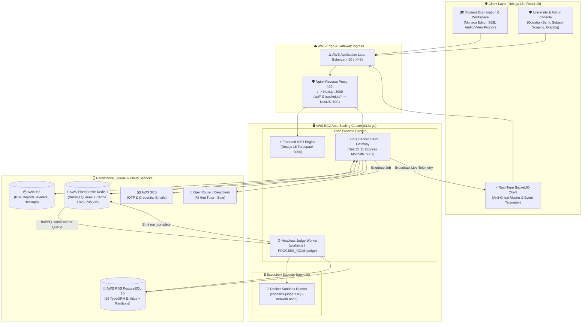
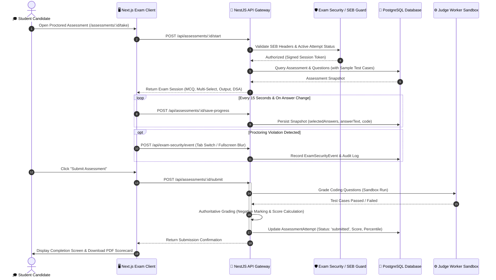
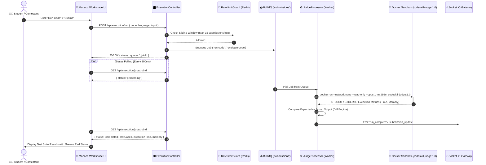
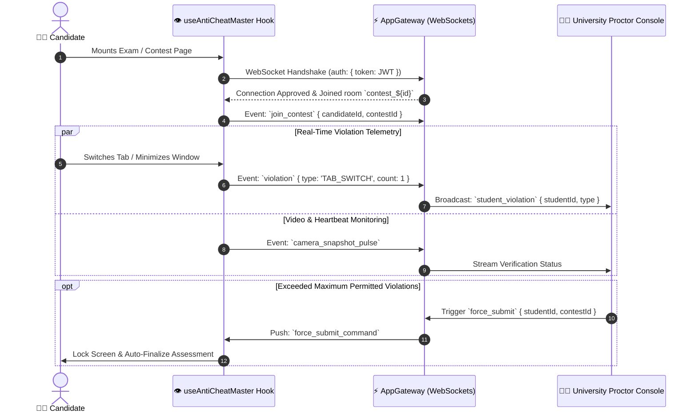

<p align="center">
  
</p>

<h1 align="center">⚡ CodeSkill Platform</h1>

<p align="center">
  <strong>Enterprise-Grade Technical Assessment, Algorithmic Evaluation & University Examination Infrastructure</strong>
</p>

<p align="center">
  <a href="#-architecture-overview"></a>
  <a href="#-tech-stack"></a>
  <a href="#-tech-stack"></a>
  <a href="#-tech-stack"></a>
  <a href="#-code-execution-sandbox"></a>
  <a href="#-infrastructure--deployment"></a>
  <a href="#-security-and-anti-cheat-telemetry"></a>
  <a href="#-test-suite--verification"></a>
</p>

<p align="center">
  <a href="#-executive-overview">Overview</a> •
  <a href="#-system-architecture">Architecture</a> •
  <a href="#-end-to-end-workflows">Workflows</a> •
  <a href="#-code-execution-sandbox">Judge Sandbox</a> •
  <a href="#-security-and-anti-cheat-telemetry">Security & Proctoring</a> •
  <a href="#-66-column-bulk-question-ingestion">Question Ingestion</a> •
  <a href="#-repository-structure">Repository</a> •
  <a href="#-quick-start-local-development">Quick Start</a> •
  <a href="#-production-deployment">Production AWS</a>
</p>

---

## 📌 Executive Overview

**CodeSkill** is an enterprise-scale online examination, coding practice, competitive programming, and proctored assessment platform built for prestigious academic institutions (such as **Chandigarh University**) and corporate recruitment teams.

The platform provides:
1. **High-Stakes Academic Examinations**: Proctored tests with semester, year, and subject-wise access controls, Safe Exam Browser (SEB) lockouts, and automated grading for Single Choice, Multi-Select, Code-Output, and DSA Coding questions.
2. **Isolated Multi-Language Judge Engine**: Zero-trust Docker container sandbox (`codeskill-judge:1.0`) enforcing strict CPU, memory, execution timeouts, non-root privileges, and network isolation (`--network none`).
3. **Live Anti-Cheat & Telemetry Hub**: Real-time Socket.IO bidirectional monitoring capturing window blurs, full-screen exits, multi-monitor setups, and web camera proctoring.
4. **LeetCode-Style Practice & Coding Contests**: Timed algorithmic competitions with dynamic leaderboards, penalty calculations, and personalized AI hint tutors ("Byte Companion").
5. **Automated Institutional Administration**: Bulk CSV imports for 66-column question schemas, student batches, automated deduplication, and PDF grade report generation.

---

## 🏛️ System Architecture

CodeSkill employs a **modern decoupled architecture** featuring an optimized Next.js 16 App Router frontend, a high-throughput NestJS 11 backend API, Redis-backed BullMQ job queues, and an autonomous Judge Worker execution service.



---

## 🔄 End-to-End Workflows

### 1. Proctored University Examination Lifecycle



---

### 2. Zero-Trust Distributed Code Execution Pipeline



---

### 3. Real-Time Anti-Cheat Proctoring & Telemetry



---

## 🔒 Code Execution Sandbox (`codeskill-judge:1.0`)

CodeSkill compiles and executes untrusted student-submitted code in a custom hardened Docker sandbox environment.

### Supported Language Toolchains
| Language | Runtime Version | Execution Mode | Adapter Entry |
| :--- | :--- | :--- | :--- |
| **C** | GCC 12 (C17) | Compiled Binary | `codeskill-judge:1.0` |
| **C++** | G++ 12 (C++20) | Compiled Binary (`-O2 -std=c++20`) | `codeskill-judge:1.0` |
| **Java** | OpenJDK 17 / 21 | Compiled Bytecode (`javac` / `java`) | `codeskill-judge:1.0` |
| **Python** | Python 3.11 | Interpreted | `codeskill-judge:1.0` / `python:3.11-alpine` |
| **JavaScript** | Node.js 20 LTS | V8 Engine | `codeskill-judge:1.0` / `node:20-alpine` |
| **TypeScript** | Node.js 20 + TSX | Direct Execution (`tsx`) | `codeskill-judge:1.0` |
| **Go** | Golang 1.22 | Compiled Binary | `codeskill-judge:1.0` |
| **Rust** | Rust 1.77 (`rustc`) | Compiled Binary (`-O`) | `codeskill-judge:1.0` |

### Security Isolation Parameters
Every execution runs with strict Linux kernel cgroups and namespace restrictions:
```bash
docker run --rm \
  --network none \
  --read-only \
  --user 1000:1000 \
  --cpus 1.0 \
  --memory 256m \
  --memory-swap 256m \
  --pids-limit 64 \
  --cap-drop ALL \
  --security-opt no-new-privileges \
  --tmpfs /tmp:rw,noexec,nosuid,size=64m \
  -v /var/run/codeskill/jobs/<id>:/app:ro \
  codeskill-judge:1.0 <command>
```

---

## 🛡️ Security Architecture & Hardening Matrix

Following the **End-to-End Technical & Security Audit**, all 18 discovered system vulnerabilities and edge cases have been completely remediated:

| Audit ID | Category | Threat / Vulnerability | Engineering Remediation |
| :--- | :--- | :--- | :--- |
| **AUD-001** | Reliability | `SubmissionRateLimitGuard` blocked job polling | Moved guard from controller class to `@Post('run')` only; polling endpoint is unrestricted for authenticated job owners. |
| **AUD-002** | Correctness | Multi-choice, `CODE_OUTPUT`, and DSA test case misgrading | Rebuilt grading logic in `AssessmentsService`; added multi-select array states and text answer validation. |
| **AUD-003** | Deployment | Missing Docker engine on EC2 instances | Added Docker provisioning scripts, `Dockerfile.judge`, and container pre-pulls in Terraform user-data. |
| **AUD-004** | Reliability | Redis Cluster vs Standalone mismatch | Synchronized BullMQ Redis configuration with `REDIS_CLUSTER_MODE` environment flags. |
| **AUD-005** | Security | Global IP login lockout behind Nginx & `ILIKE` wildcard injection | Enabled `trust proxy`, forwarded `X-Forwarded-For` in Nginx, and replaced `ILIKE` with parameterized exact equality. |
| **AUD-006** | DevSecOps | Hardcoded JWT fallback secret in Terraform | Added fallback keys to `FORBIDDEN_SECRETS`, deleted legacy passwords, and enforced SSM parameter resolution. |
| **AUD-007** | Database | Unexecuted `auth-tokens-schema` migration | Exported and integrated automated migration script ensuring `tokenVersion` and `refresh_tokens` exist on boot. |
| **AUD-008** | Compute | Undersized `t3.micro` vs PM2 memory footprint | Upgraded production ASG to `t3.large` (8 GB RAM) and tuned worker concurrency. |
| **AUD-009** | Security | Contest WebSocket handshake rejected unauthenticated connections | Added authenticated token passing (`auth: { token }`) in `useAntiCheatMaster.ts`. |
| **AUD-010** | Correctness | Route shadowing (`@Get(':id')` vs `@Get(':username')`) & cross-tenant IDOR | Disambiguated routes, added UUID format checks, and enforced tenant verification guards. |
| **AUD-011** | Integrity | Client-spoofable Safe Exam Browser flag | Validated `x-safeexambrowser-requesthash` / `configkeyhash` cryptographic headers. |
| **AUD-012** | Security | Unrestricted HTTP CORS (`origin: true`) | Replaced wildcard CORS with strict domain allowlists in `main.ts`. |
| **AUD-013** | Reliability | Active submission counter drift across retries | Implemented clamped Redis Lua decrement scripts to prevent negative counter states. |
| **AUD-014** | Execution | TypeScript runner failed under `--network none` | Preinstalled `tsx` inside `codeskill-judge:1.0` for offline container runs. |
| **AUD-015** | Disaster Recovery | Ephemeral database backups without S3 upload | Added `set -euo pipefail`, automated S3 push, and enabled RDS `deletion_protection = true`. |
| **AUD-016** | Security | Disabled TLS certificate verification (`rejectUnauthorized: false`) | Mounted AWS RDS CA bundle (`rds-global-bundle.pem`) and enforced TLS validation. |
| **AUD-017** | Integrity | Unbounded memory growth & AI Pet availability in exams | Bounded rate-limit maps and blocked students with active exam attempts from querying the AI tutor. |
| **AUD-018** | Maintainability | Untyped discussion controllers & stale deploy scripts | Added DTOs with `class-validator` decorators and updated shell scripts. |

---

## 📊 66-Column Bulk Question Ingestion

CodeSkill features a high-throughput question ingestion engine capable of parsing, validating, deduplicating, and importing algorithmic coding questions via CSV or JSON formats.

```
question_id, title, slug, question_type, topic, subtopic, difficulty, marks, negative_marks,
language, supported_languages, constraints, problem_statement, input_format, output_format,
sample_input, sample_output, explanation, hints, approach, expected_time_complexity,
expected_space_complexity, starter_code_c, starter_code_cpp, starter_code_java,
starter_code_python, starter_code_javascript, starter_code_go, starter_code_rust,
solution_code_c, solution_code_cpp, solution_code_java, solution_code_python,
solution_code_javascript, solution_code_go, solution_code_rust, test_input_1, test_output_1,
test_visibility_1, test_input_2, test_output_2, test_visibility_2, test_input_3, test_output_3,
test_visibility_3, test_input_4, test_output_4, test_visibility_4, test_input_5, test_output_5,
test_visibility_5, time_limit_ms, memory_limit_mb, execution_mode, entry_point, function_name,
return_type, input_type, output_type, allow_custom_input, compare_mode, partial_scoring,
is_active, tags, created_by, version
```

### Key Ingestion Capabilities:
- **Automatic Content Fingerprinting**: Computes deterministic SHA-256 digests on normalized text to detect and flag duplicate questions across batches.
- **Dynamic Language Splitting**: Ingests individual starter templates and reference solutions for 7 programming languages in a single row.
- **Multi-Tier Test Case Visibility**: Maps test cases 1 through 5 as `sample` (visible in problem description), `hidden` (evaluated during submission), or `locked` (used for final contest scoring).
- **Subject & Semester Scoping**: Tags imported questions with University Academic Subject IDs, Semester levels, and Year cohorts.

---

## 🗂️ Repository Structure

```
codeskill/
├── backend-nestjs/                    # Core Backend API & Judge Worker Service
│   ├── docker/
│   │   └── Dockerfile.judge           # Multi-language sandbox Docker container
│   ├── src/
│   │   ├── admin/                     # University & administrative management
│   │   ├── assessments/               # Proctored tests, attempts, grading logic
│   │   ├── auth/                      # JWT auth, token rotation, rate limiters
│   │   ├── campus/                    # University tenant management & portals
│   │   ├── common/                    # Filters, guards, interceptors, pipes
│   │   ├── companies/                 # Corporate recruiter assessment portals
│   │   ├── config/                    # JWT, database, Redis, S3, and AWS configs
│   │   ├── contests/                  # Coding contests, leaderboards, reattempts
│   │   ├── database/                  # TypeORM entities, migrations, and sharding
│   │   │   ├── entities/              # 29 PostgreSQL TypeORM Domain Entities
│   │   │   └── migrations/            # Idempotent DDL schema migration scripts
│   │   ├── discussions/               # Forum threads and discussion replies
│   │   ├── exam-security/             # SEB validation and violation telemetry
│   │   ├── execution/                 # JudgeProcessor, BullMQ, Docker sandboxing
│   │   ├── gateway/                   # WebSockets gateway for real-time events
│   │   ├── pet/                       # AI coding tutor companion ("Byte")
│   │   ├── problems/                  # Public practice catalogue & CTE queries
│   │   ├── questions/                 # Question bank & 66-column parser engine
│   │   ├── reports/                   # Automated PDF scorecard generators
│   │   ├── students/                  # Batch student enrollment & CSV import
│   │   ├── subjects/                  # Academic subject curriculum management
│   │   ├── submissions/               # Code submission tracking and metrics
│   │   ├── main.ts                    # HTTP API Server Entrypoint (:5001)
│   │   └── worker.ts                  # Dedicated Judge Worker Entrypoint
│   └── package.json
│
├── frontend-v2/                       # Next.js 16 App Router Web Application
│   ├── src/
│   │   ├── app/                       # App Router Pages & Layouts
│   │   │   ├── (auth)/login/          # Student credential login portal
│   │   │   ├── admin/                 # Administration dashboards & tools
│   │   │   ├── assessments/           # Proctored examination workspace
│   │   │   ├── contests/              # Live contest lobbies & attempt rooms
│   │   │   ├── problems/              # LeetCode-style practice workspace
│   │   │   └── leaderboard/           # Global rankings and contest scorecards
│   │   ├── components/                # Modular React 19 UI components
│   │   │   ├── admin/                 # Admin data tables, uploaders, navigations
│   │   │   ├── assessments/           # MCQ, Multi-Select, Output, and DSA widgets
│   │   │   ├── landing/               # High-contrast hero & feature displays
│   │   │   ├── problems/              # Monaco editor, test case runner, console
│   │   │   └── ui/                    # Reusable design tokens, tables, modals
│   │   ├── hooks/                     # Custom React hooks (anti-cheat, timers)
│   │   └── lib/                       # API clients, axios interceptors, stores
│   └── package.json
│
├── terraform/                         # Production AWS Infrastructure as Code
│   ├── environments/production/       # Production environment definitions
│   └── modules/                       # Reusable modules (VPC, ASG, ALB, RDS, Redis)
│
├── scripts/                           # Maintenance, admin creation, and backup scripts
├── docker-compose.yml                 # Local PostgreSQL 15 & Redis 7 stack
└── ecosystem.config.js                # PM2 cluster configuration for EC2
```

---

## 🚀 Quick Start (Local Development)

### Prerequisites
- **Node.js**: `20.x` or higher
- **Docker Engine**: Installed and running
- **PostgreSQL**: `15.x` (or via Docker Compose)
- **Redis**: `7.x` (or via Docker Compose)

### 1. Clone & Setup Infrastructure Containers
```bash
git clone https://github.com/sazamansari/codeskill.git
cd codeskill

# Start local PostgreSQL 15 and Redis 7
docker-compose up -d postgres redis
```

### 2. Build the Multi-Language Sandbox Image
```bash
docker build -t codeskill-judge:1.0 -f backend-nestjs/docker/Dockerfile.judge backend-nestjs
```

### 3. Backend Setup & Database Migration
```bash
cd backend-nestjs
npm install

# Setup environment variables
cp .env.example .env

# Run database synchronization / migrations
npm run build
node dist/database/run-practice-submission-source.js

# Start NestJS in Development Mode (Port 5001)
npm run start:dev
```

### 4. Background Judge Worker Setup (Optional for execution testing)
```bash
# In a separate terminal tab:
cd backend-nestjs
PROCESS_ROLE=judge npm run start:dev
```

### 5. Frontend Setup
```bash
cd ../frontend-v2
npm install

# Start Next.js Development Server (Port 3000)
npm run dev
```

Open [http://localhost:3000](http://localhost:3000) in your browser to access CodeSkill.

---

## 🧪 Test Suite & Verification

The platform is fortified with end-to-end integration and unit tests across every module.

### Run Backend Test Suite (NestJS / Jest)
```bash
cd backend-nestjs
npm test
```
```
Test Suites: 34 passed, 34 total
Tests:       349 passed, 349 total
Snapshots:   0 total
Time:        19.71 s
```

### Run Frontend Test Suite (Next.js / Jest)
```bash
cd frontend-v2
npm test
```
```
Test Suites: 28 passed, 28 total
Tests:       231 passed, 231 total
Snapshots:   0 total
Time:        6.24 s
```

### Static Type Check
```bash
# Backend TypeScript Check
cd backend-nestjs && npx tsc --noEmit

# Frontend TypeScript Check
cd frontend-v2 && npx tsc --noEmit
```

---

## ☁️ Production Deployment (AWS)

CodeSkill is automated via **Terraform** and **GitHub Actions** for resilient, zero-downtime blue/green deployments:

```bash
# Initialize Terraform Production Environment
cd terraform/environments/production
terraform init
terraform plan
terraform apply
```

### Architecture Specifications:
- **Compute**: AWS Auto Scaling Group with `t3.large` instances running PM2 cluster (Next.js SSR + NestJS API + Judge Worker).
- **Database**: AWS RDS PostgreSQL 15 Multi-AZ with automated snapshots, `deletion_protection = true`, and SSL CA verification.
- **Cache & Queue**: AWS ElastiCache Redis 7 managing BullMQ job distribution.
- **Load Balancer**: AWS Application Load Balancer with HTTPS termination, rate limiting, and sticky sessions.

---

## 📄 License & Academic Attribution

Developed for **Chandigarh University** Official Technical Assessment & Examination Infrastructure.  
Maintained by the CodeSkill Core Engineering & Security Team.
