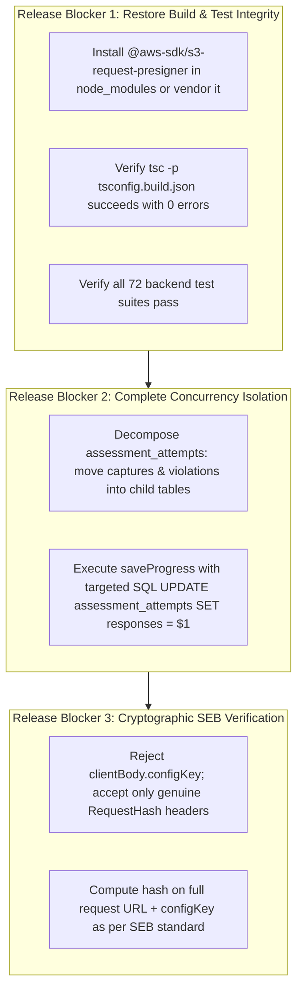

# Pre-Production Engineering Audit Re-Assessment: Executive Summary

**Date:** October 18, 2026  
**Target Repository:** CodeSkill Platform (`backend-nestjs` & `frontend-v2`)  
**Commit Inspected:** `b846d107` (Merge PR #95 `fix/audit-003-remediation`)  
**Audit Scope:** Full-Stack Pre-Production Engineering Re-Assessment (17 Engineering Disciplines)  
**Audit Mode:** Non-Destructive, Read-Only, Independent Multi-Disciplinary Analysis  
**Output Location:** `engineering-audit/`  

---

## 1. Executive Synthesis & Verdict

### Production Readiness Verdict: **NOT PRODUCTION READY (RELEASE BLOCKED)**

Following the initial audit and the subsequent merge of PR #95 (`b846d107`), the CodeSkill platform made targeted progress in several areas:
- **Telemetry Routing Fixed:** `HealthAndTelemetryController` correctly routes to `telemetry/client-events`, eliminating the previous 404 route collision.
- **Health Route Shadowing Resolved:** Competing health check endpoints were deduplicated.
- **Metrics Scraping Hardened:** Prometheus IP check now uses strict RFC 1918 CIDR regexes instead of substring matching.
- **Credential Storage Secured:** Temporary student passwords in `email_jobs` are now encrypted via AES-256-GCM.
- **Partition Horizon Extended:** Declarative partitioning added a catch-all default partition and yearly tables through 2030.
- **TypeORM Safety Enforced:** `null: 'throw'` was applied to prevent BOLA query stripping.
- **Discussion Voting Protected:** Discussion upvotes/downvotes now run inside pessimistic write-locked transactions.

However, a rigorous independent reassessment of commit `b846d107` reveals **critical new and unaddressed pre-production release blockers**:

1. **Broken Dependency & Immediate TypeScript/Test Failure (NEW CRITICAL DEFECT):**
   - PR #95 introduced `import { getSignedUrl } from '@aws-sdk/s3-request-presigner';` in `backend-nestjs/src/s3/s3.service.ts` and added it to `package.json`.
   - However, the package was never installed in `node_modules`. As a result, backend compilation (`tsc -p tsconfig.build.json --noEmit`) hard-fails with TS2307 (`Cannot find module '@aws-sdk/s3-request-presigner'`), 9 backend test suites immediately fail to run, and the production backend crashes on startup.
2. **Incomplete Concurrency Fix & Persistent Assessment Data Loss Hazard:**
   - In `backend-nestjs/src/assessments/assessments.service.ts`, PR #95 added a `findOne` reload inside `recordProctorCapture` *after* the S3 upload.
   - However, `saveProgress` (lines 1531–1638) still reads the full entity, updates `attempt.responses`, and calls `await this.attemptRepo.save(attempt)` without any row locks or version checks.
   - If `saveProgress` executes `findOne` while `recordProctorCapture` is saving, `saveProgress` writes back its stale snapshot, clobbering the proctoring capture array. Conversely, if `recordProctorCapture` writes after `saveProgress`, student code is erased. The core architectural flaw—storing high-frequency webcam telemetry and student exam code in a single non-locked entity row—remains unaddressed.
3. **Flawed Safe Exam Browser (SEB) Verification Logic:**
   - In `backend-nestjs/src/exam-security/exam-security.service.ts`, `clientType` is set to `'SEB'` if `clientBody.isSEB || hasSebHeader || isSebUserAgent`. If `security.configKey` is not configured, any browser sending `{ isSEB: true }` or spoofing the User-Agent still bypasses SEB enforcement.
   - Even when `security.configKey` is set, the server permits `clientSentKey === expectedConfigKey`, allowing attackers to supply the secret key in plaintext JSON rather than sending cryptographic RequestHash headers.
   - Furthermore, the server's hash check hashes `assessment.id + expectedConfigKey` rather than the genuine SEB standard of `URL + ConfigKey`, making genuine SEB clients incompatible with the platform.
4. **O(N) Piston Compilation Multiplier Unchanged:**
   - Multi-test submissions still compile code $T$ times for $T$ test cases in `execution.service.ts`, maintaining an 8.1× CPU amplification factor on execution hosts.
5. **Shared Single Redis Instance with `noeviction`:**
   - BullMQ, rate limiting, and WebSockets share a single Redis instance with `maxmemory-policy: noeviction`. Memory exhaustion halts all job queuing and user logins.

---

## 2. Engineering Maturity Assessment

| Discipline | Maturity Level | Rating (1-5) | Assessment on Commit `b846d107` |
| :--- | :--- | :---: | :--- |
| **System Architecture** | Transitional | 3.0 / 5 | Modular service boundaries, but build is broken by uninstalled presigner dependency. |
| **Frontend Architecture** | Mature | 3.5 / 5 | Next.js 15 / React 19; all 47 frontend unit suites pass (344 tests); clean typecheck. |
| **Backend & API Architecture** | Broken Build | 2.0 / 5 | Backend `tsc` fails with code 2; 9 test suites fail due to missing `@aws-sdk/s3-request-presigner`. |
| **Database Architecture** | Moderate Risk | 3.0 / 5 | Partitioning horizon fixed to 2030; `null: 'throw'` applied; overloaded entity persists. |
| **Concurrency & Integrity** | High Risk | 2.5 / 5 | Partial reload in `recordProctorCapture` does not prevent race with `saveProgress`. |
| **Application Security** | Moderate Risk | 2.5 / 5 | Passwords now encrypted in `email_jobs`; SEB verification contains multiple bypass vectors. |
| **SRE & Reliability** | Moderate Risk | 2.5 / 5 | Telemetry route prefix fixed; RDS max_connections bumped to 200; shared Redis `noeviction` persists. |
| **Performance & Scalability** | High Risk | 2.0 / 5 | Piston multi-compilation multiplier remains unaddressed; 200 connections on 1GB RAM RDS risks OOM. |
| **QA & Test Automation** | Degraded | 2.5 / 5 | 9 test suites fail in backend due to module import failure. Frontend suite maintains 100% pass rate. |

---

## 3. Discovered Vulnerability & Defect Register Summary

| Severity Level | Count | Definition & Production Impact |
| :--- | :---: | :--- |
| **CRITICAL** | **2** | Uninstalled module dependency breaks backend build/startup; persistent race condition in assessment saves causes student data loss. |
| **HIGH** | **4** | Safe Exam Browser logic flaws allow lockdown bypass; Piston multi-compilation CPU multiplier; shared Redis `noeviction` OOM; RDS memory pressure with 200 connections on `db.t4g.micro`. |
| **MEDIUM** | **4** | In-memory Pet rate limiter not shared across cluster instances; non-standard SEB URL hash computation; un-isolated BullMQ queues; missing composite indexes. |
| **LOW** | **2** | React 19 ref access during render in `contribution-skyline.tsx`; synchronous `setState` inside `useEffect` triggering cascading renders. |
| **TOTAL ISSUES** | **12** | **Independent findings inventory across 14 specialized reports.** |

---

## 4. Immediate Remediation Action Plan

