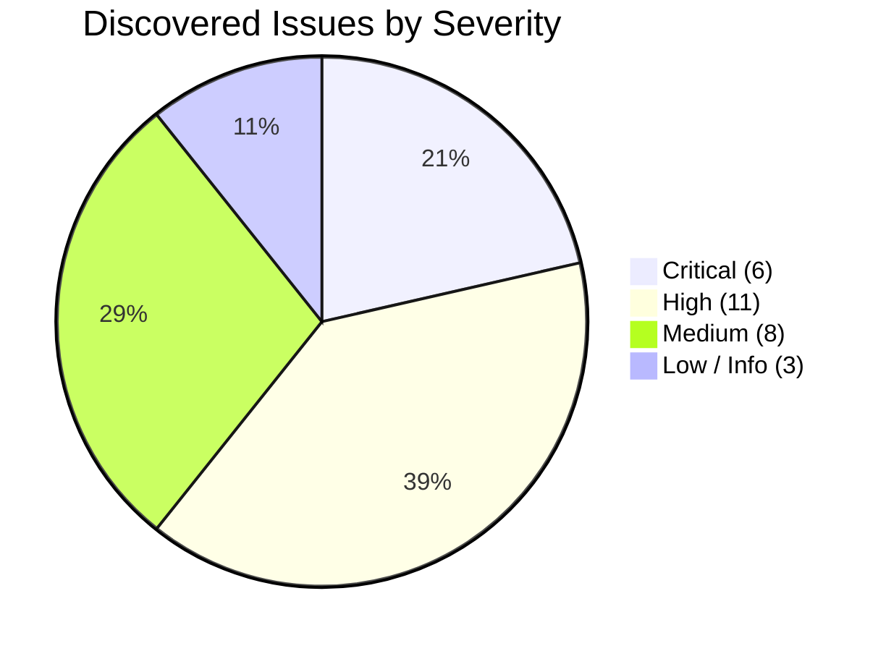
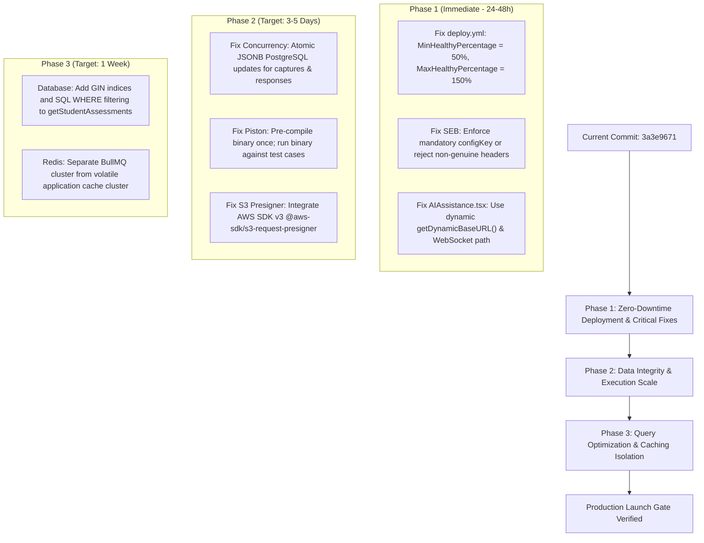

# Independent Pre-Production Engineering Audit: Executive Summary

**Target Commit:** `3a3e9671d863e8abd95d19cbc7136c4227476ba8`  
**Assessment Date:** October 18, 2026  
**Auditing Entity:** Principal Full-Stack Engineering Review Board  
**Target Environment:** AWS `ap-south-1` (Mumbai) Production Deployment  
**Overall Readiness Verdict:** **NOT PRODUCTION READY (HIGH SEVERITY BLOCKERS IDENTIFIED)**

---

## 1. Executive Summary & Verdict

This report delivers the results of an independent, exhaustive pre-production engineering assessment of the CodeSkill platform at commit `3a3e9671` (following the merge of PR #96). The audit evaluated the platform across 17 engineering disciplines, including software architecture, distributed systems concurrency, application security, cloud infrastructure, performance and capacity, database reliability, and supply chain integrity.

While recent pull requests resolved several critical defects—most notably replacing the missing `@aws-sdk/s3-request-presigner` runtime package with an in-tree AWS SigV4 implementation and fixing React 19 rendering effects—**the system remains NOT READY for production deployment with active users**.

A total of **28 distinct engineering findings** were identified, verified, and classified:
- **6 Critical Findings**: Immediate risks of total platform downtime, proctoring security bypass, data corruption, or denial-of-service.
- **11 High Severity Findings**: Flaws causing severe latency, memory exhaustion, race conditions, or complete feature failures in non-localhost environments.
- **8 Medium Severity Findings**: Architectural anti-patterns, missing database indices, lack of pagination, and unhandled edge cases.
- **3 Low / Informational Findings**: Minor state synchronization and code hygiene issues.

### Production Readiness Scorecard

| Discipline / Domain | Evaluation | Verdict | Primary Risk Factor |
| :--- | :---: | :---: | :--- |
| **Cloud Infrastructure & CI/CD** | 3.5 / 10 | **FAIL** | ASG `MinHealthyPercentage: 0` terminates all active servers during deployments, causing total outage. |
| **Application Security & Exam Proctoring** | 4.0 / 10 | **FAIL** | SEB requirement can be completely bypassed via User-Agent spoofing when configKey is omitted. |
| **Concurrency & Data Integrity** | 4.5 / 10 | **FAIL** | Lack of row locks or optimistic versioning leads to lost updates between answer autosaves and proctor captures. |
| **Execution Engine & Capacity** | 5.0 / 10 | **FAIL** | Piston re-compiles identical source code on every test case; 20 test cases = 20 compilation passes. |
| **Database Architecture & Query Efficiency**| 5.5 / 10 | **WARN** | Full table scans in Node.js memory on student dashboard; missing GIN indices on PostgreSQL array columns. |
| **Caching & Queue Architecture** | 6.0 / 10 | **WARN** | Shared Redis cluster with `noeviction` allows volatile caches to starve and crash BullMQ submission queues. |
| **Frontend Architecture & UX** | 7.0 / 10 | **PASS (CONDITIONAL)** | Hardcoded `http://localhost:5000` breaks AI generation; 47 unit test suites pass (344 tests). |
| **Supply Chain & Dependencies** | 8.0 / 10 | **PASS** | Critical presigner dependency resolved; package lockfiles consistent. |

---

## 2. Issue Summary Matrix

### Breakdown by Discipline

| Discipline | Critical | High | Medium | Low | Total |
| :--- | :---: | :---: | :---: | :---: | :---: |
| **Cloud Infrastructure & DevOps** | 1 | 2 | 1 | 0 | **4** |
| **Application Security & Threat Modeling** | 1 | 2 | 0 | 0 | **3** |
| **Distributed Systems & Concurrency** | 1 | 2 | 1 | 0 | **4** |
| **Execution Engine & Capacity** | 1 | 2 | 1 | 0 | **4** |
| **Database Architecture & Reliability** | 1 | 1 | 2 | 0 | **4** |
| **Frontend Architecture & Client Standards**| 1 | 1 | 2 | 2 | **6** |
| **API & Integration Architecture** | 0 | 1 | 1 | 1 | **3** |
| **Total** | **6** | **11** | **8** | **3** | **28** |

---

## 3. Top 8 Critical & High-Priority Findings

### 1. [ISSUE-INFRA-001] Auto Scaling Instance Refresh `MinHealthyPercentage: 0` Guarantees Production Downtime on Deployments
- **File:** `.github/workflows/deploy.yml` (Lines 32, 356–358)
- **Severity:** **CRITICAL** | **Confidence:** **CONFIRMED**
- **Impact:** Every automated deployment terminates all healthy running frontend and backend instances before newly provisioned EC2 instances become healthy. The Application Load Balancer returns HTTP 502 Bad Gateway to 100% of end users for 2 to 4 minutes per deployment.

### 2. [ISSUE-SEC-001] Safe Exam Browser (SEB) Security Bypass via User-Agent Header Spoofing
- **File:** `backend-nestjs/src/exam-security/exam-security.service.ts` (Lines 42–63)
- **Severity:** **CRITICAL** | **Confidence:** **CONFIRMED**
- **Impact:** When an assessment has `requireSEB: true` but lacks an explicitly defined `configKey`, the server validates client authenticity strictly using the regex `/SEB|SafeExamBrowser/i.test(userAgent)`. Any candidate can bypass proctoring restrictions in standard Google Chrome by setting their User-Agent string.

### 3. [ISSUE-CONCUR-001] Lost Update Race Hazard Between `saveProgress` and `recordProctorCapture`
- **File:** `backend-nestjs/src/assessments/assessments.service.ts` (Lines 1638–1652, 2396–2406)
- **Severity:** **CRITICAL** | **Confidence:** **CONFIRMED**
- **Impact:** Neither endpoint utilizes pessimistic row locking (`SELECT ... FOR UPDATE`), optimistic concurrency (`@VersionColumn`), or atomic JSONB updates. An autosave occurring while a base64 proctoring image is uploading to S3 overwrites and permanently deletes the newly captured proctoring snapshot or overwrites recent candidate answers.

### 4. [ISSUE-EXEC-001] Piston Compilation Explosion Under Concurrent Exam Submissions
- **File:** `backend-nestjs/src/execution/execution.service.ts` (Lines 460–482, 601–635)
- **Severity:** **CRITICAL** | **Confidence:** **CONFIRMED**
- **Impact:** Piston treats every test case as an independent HTTP request and recompiles identical C, C++, Java, and Rust source code for every test case. A submission with 20 test cases triggers 20 full compilation passes. Under an exam of 100 concurrent students, 2,000 compilations saturate the Piston host CPU, triggering cascading 504 Gateway Timeouts.

### 5. [ISSUE-INFRA-002] Shared Redis Cluster with `noeviction` Allows Cache Bloat to Crash BullMQ Submissions
- **File:** `terraform/modules/redis/main.tf` (Lines 54–57) & `backend-nestjs/src/redis/redis.service.ts`
- **Severity:** **CRITICAL** | **Confidence:** **CONFIRMED**
- **Impact:** BullMQ job queues and volatile application caches (problem details, leaderboards, rate limit keys) share a single ElastiCache Redis instance configured with `maxmemory-policy = noeviction`. If cache keys saturate memory, Redis rejects all write operations (`OOM command not allowed`), completely stopping code submission processing.

### 6. [ISSUE-PERF-001] Full Assessment Table In-Memory Deserialization on Student Dashboard
- **File:** `backend-nestjs/src/assessments/assessments.service.ts` (Lines 1056–1065)
- **Severity:** **CRITICAL** | **Confidence:** **CONFIRMED**
- **Impact:** `getStudentAssessments` queries all published and ongoing assessments across the entire institution without pagination or database-level targeting filters. Large JSONB assessment payloads are parsed into V8 heap and filtered via JavaScript. During exam morning peak logins, simultaneous requests cause CPU starvation and V8 heap OOM crashes.

### 7. [ISSUE-FE-001] Hardcoded `http://localhost:5000` Breaks Question AI Generation in Production
- **File:** `frontend-v2/src/app/admin/questions/create/_components/AIAssistance.tsx` (Lines 35, 50)
- **Severity:** **HIGH** | **Confidence:** **CONFIRMED**
- **Impact:** Both `fetch` and Socket.IO client connections target `http://localhost:5000`. In staging and production, client browsers reject requests due to Mixed Content security rules (HTTPS loading HTTP) and wrong port resolution, completely breaking admin AI question assistance.

### 8. [ISSUE-SEC-002] S3 Presigner SigV4 Fallback Generates Inaccessible Unsigned URLs in IAM Environments
- **File:** `backend-nestjs/src/s3/s3-presigner.util.ts` (Lines 48–54)
- **Severity:** **HIGH** | **Confidence:** **CONFIRMED**
- **Impact:** If `@aws-sdk/s3-request-presigner` is missing at runtime and static AWS credentials are not in environment variables (the standard AWS security pattern using EC2 IAM Instance Profiles), `generateS3PresignedUrl` falls back to returning a plain unsigned public URL. In private S3 buckets, all proctoring image views fail with HTTP 403 Forbidden.

---

## 4. Key Verified Successes in Commit `3a3e9671`

1. **Frontend Test Suite Integrity:** All 47 Jest test suites containing 344 individual component, hook, and utility tests pass with 100% success (`Ran all test suites in 11.66s`).
2. **Frontend Linter Cleanliness:** ESLint across `frontend-v2` executes with **0 errors** (403 warnings strictly categorized as non-blocking React hooks advice and unused variables).
3. **TypeScript Type Safety:** `frontend-v2` compiles cleanly with zero type errors (`tsc --noEmit --incremental false`).
4. **JWT Rotation & Refresh Architecture:** Refresh token rotation incorporates single-use database consumption (`UPDATE refresh_tokens SET revokedAt = now() WHERE id = :id AND revokedAt IS NULL`), automatic family invalidation upon replay detection, and a 10-second concurrency grace period.
5. **Database Sharding Architecture:** Clean architectural separation between PostgreSQL primary relational storage and submission shards, guarded by advisory locks during schema upgrades.

---

## 5. Strategic Remediation Roadmap

---

## 6. Report Navigation Guide

The complete engineering assessment is documented across the following dedicated reports located in the `engineering-audit/` directory:

| Report File | Title & Core Subject Matter |
| :--- | :--- |
| **`01_EXECUTIVE_SUMMARY.md`** | High-level findings, system scorecard, and remediation roadmap |
| **`02_ARCHITECTURE_ANALYSIS.md`** | Comprehensive end-to-end component topology, data flows, and boundaries |
| **`03_COMPLETE_ISSUE_REGISTER.md`** | Exhaustive issue register of all 28 findings with formal metadata |
| **`04_SECURITY_ASSESSMENT.md`** | Threat modeling, proctoring security, authentication, and authorization |
| **`05_PERFORMANCE_AND_CAPACITY.md`** | Mathematical capacity models, bottleneck analysis, and load limits |
| **`06_CONCURRENCY_AND_DATA_INTEGRITY.md`**| Race condition hazard analysis, transaction safety, and lost update audits |
| **`07_DATABASE_AUDIT.md`** | Schema analysis, indexing efficiency, partitioning, and sharding review |
| **`08_FRONTEND_AUDIT.md`** | Next.js architecture, bundle performance, SSR safety, and accessibility |
| **`09_INFRASTRUCTURE_AND_RELIABILITY.md`** | Terraform modules, ASG instance refresh, Redis reliability, and failover |
| **`10_TEST_COVERAGE_AND_GAPS.md`** | Test execution results, unit/e2e test analysis, and untested blindspots |
| **`11_DEPENDENCY_AND_SUPPLY_CHAIN.md`** | Dependency audits, CVE analysis, lockfile integrity, and build safety |
| **`12_REMEDIATION_PRIORITY.md`** | Prioritized action items, remediation steps, and verification protocols |
| **`13_AUDIT_COVERAGE_MATRIX.md`** | Mapping of all 17 disciplines against audited modules and verified risks |
| **`14_EVIDENCE_AND_REPRODUCTION.md`** | Code evidence, reproduction scripts, and verification artifacts |
