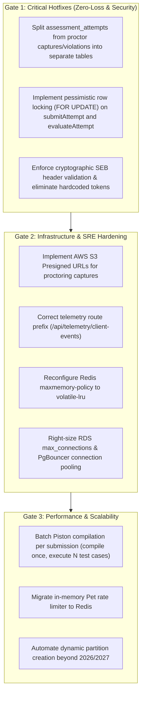

# Pre-Production Engineering Audit: Executive Summary

**Date:** October 18, 2026  
**Target Repository:** CodeSkill Platform (`backend-nestjs` & `frontend-v2`)  
**Commit Inspected:** `2d89bd45` (HEAD -> main)  
**Audit Scope:** Full-Stack Pre-Production Engineering Assessment (17 Engineering Disciplines)  
**Audit Mode:** Non-Destructive, Read-Only, Independent Static & Empirical Analysis  

---

## 1. Executive Synthesis & Verdict

### Production Readiness Verdict: **NOT PRODUCTION READY (RELEASE BLOCKED)**

The CodeSkill platform demonstrates sophisticated functional capabilities, including multi-language automated code judging, Safe Exam Browser (SEB) proctoring hooks, rich browser-based IDE integration, real-time WebSockets, dynamic problem management, contest leaderboards, and partitioned submission architectures. The development team has engineered comprehensive unit test suites (68 backend suites with 580 passing tests; 47 frontend suites with 344 passing tests) and clean TypeScript type-checking across both codebases.

However, a rigorous architectural and concurrency audit reveals **critical pre-production failure modes** that pose catastrophic risks to data integrity, system availability, and security in a concurrent production environment:

1. **Silent Student Data Loss Under Assessment Concurrency:** High-frequency proctoring background capture beacons race with periodic auto-save and submission requests on the same database entity (`assessment_attempts`). Due to non-atomic in-memory mutations without database row-level locking or isolated sub-entity tables, student code and answers are silently overwritten and destroyed in production.
2. **Double Evaluation & External Resource Exhaustion:** Assessment submission (`submitAttempt` and `evaluateAttempt`) does not execute under transactional idempotency or row locking. Simultaneous client submits or network retries trigger duplicate parallel test-case executions on the Piston/Docker backend, causing worker thread pool starvation and massive CPU spikes.
3. **Complete Safe Exam Browser (SEB) Integrity Bypass:** The exam security validation relies exclusively on a client-submitted boolean (`clientBody.isSEB`) rather than cryptographic validation of HTTP headers against SEB Config Key or Browser Exam Key hashes. Furthermore, server token generation contains hardcoded mock secrets (`simulate-secure-token`).
4. **Administrative Proctoring Evidence 403 Lockout:** Proctoring snapshot images stored in AWS S3 (`proctoring/*`) are generated with raw public URLs against a bucket policy restricting public access to `avatars/*`. The backend lacks S3 presigned URL generation, rendering candidate proctoring snapshots 100% inaccessible to instructors and administrators.
5. **Autoscaling Connection Starvation & Shared Redis OOM Cascades:** Infrastructure configurations enforce a rigid 50-connection ceiling on PostgreSQL RDS (`db.t4g.micro`) while API instances default to 50 connections each, guaranteeing immediate database failure upon horizontal autoscaling. Concurrently, a shared single Redis cluster with `maxmemory-policy: noeviction` will hard-fail all user logins, job enqueuing, and Socket.IO messages once memory thresholds are crossed.

---

## 2. Engineering Maturity Assessment

| Discipline | Maturity Level | Rating (1-5) | Primary Concern / Justification |
| :--- | :--- | :---: | :--- |
| **System Architecture** | Mature / Transitional | 3.5 / 5 | Well-structured domain boundaries; hybrid monolithic API with external execution workers. Fragile worker gateway integration. |
| **Frontend Architecture** | Moderate | 3.0 / 5 | Next.js App Router with robust Monaco editor integration; React 19 render-ref warnings, unhandled telemetry 404s, and aggressive anti-cheat heuristics. |
| **Backend & API Architecture** | Mature | 3.5 / 5 | Clean NestJS modules and DTO validation pipes; conflicting health route declarations and inconsistent telemetry path prefixes. |
| **Database Architecture** | High Risk | 2.0 / 5 | Overloaded entity columns (`responses` JSONB, `captures` JSONB); declarative partitioning is hardcoded to 2026/2027; dangerous `null: 'ignore'` in TypeORM. |
| **Concurrency & Integrity** | Critical Risk | 1.5 / 5 | Pervasive read-modify-write anti-patterns without pessimistic locks; write skew in voting; race conditions during assessment saves. |
| **Application Security** | Moderate Risk | 2.5 / 5 | Strong JWT and Argon2 hashing; SEB authentication bypass, metrics IP filter bypass, and plaintext temporary password storage in DB. |
| **SRE & Operational Reliability** | High Risk | 2.0 / 5 | Shared Redis `noeviction` policy; dual competing health controllers; worker gateway detached from HTTP server; RDS pool starvation. |
| **Performance & Scalability** | Moderate Risk | 2.5 / 5 | Piston compiles every test case independently (O(N) compilation cost per submission); in-memory unbounded rate limiting maps. |
| **Cloud Infrastructure (DevOps)** | Moderate Risk | 2.5 / 5 | Terraform modules exist for dev/prod; missing S3 presigned URL configuration, hardcoded low RDS connection caps, and single-AZ Redis. |
| **QA & Test Coverage** | Good (Static/Unit) | 3.5 / 5 | Extensive unit test coverage; complete absence of integration/concurrency tests simulating multi-client assessment autosaves. |

---

## 3. Discovered Vulnerability & Defect Register Summary

| Severity Level | Count | Definition & Production Impact |
| :--- | :---: | :--- |
| **CRITICAL** | **2** | Immediate data loss, severe vulnerability, or total platform failure under routine concurrent load. |
| **HIGH** | **7** | Major security bypass, administrative outage, infrastructure deadlocks, or silent telemetry failure. |
| **MEDIUM** | **6** | Write skew, memory leaks, unencrypted credentials in operational tables, or connection starvation risks. |
| **LOW / HYPOTHESIS** | **3** | Telemetry anomalies, minor UI re-render thrashing, and unindexed auxiliary queries. |
| **TOTAL ISSUES** | **18** | **Exhaustive audit inventory across 14 specialized reports.** |

---

## 4. Key Production Risks & Business Impact

### 4.1 Business Continuity & Reputational Risk
- **Exam Integrity Collapse:** In an academic or hiring assessment scenario, candidate answers being erased due to proctoring webcam capture overwrites represents catastrophic service failure. Candidates will receive 0 marks despite having solved problems.
- **Cheating & Proctoring Failure:** The inability to verify Safe Exam Browser cryptographic headers combined with client-side violation list overwriting allows tech-savvy candidates to bypass proctoring safeguards without detection.
- **Audit Compliance Failure:** Because proctoring evidence in S3 returns 403 Forbidden, organizations cannot verify candidate identity or violation snapshots during compliance reviews.

### 4.2 Scalability & Operational Risks
- **The "Assessment Rush" Bottleneck:** When 200 candidates begin or submit an assessment at the same time:
  1. Competing auto-saves and proctor captures hammer the single `assessment_attempts` table.
  2. Submissions trigger un-batched C++/Java recompilations in Piston (200 submissions × 15 test cases = 3,000 Piston compilations in parallel).
  3. CPU hits 100%, queue lengths explode, and workers fail to report results within socket timeouts.
  4. Autoscaling launches additional API containers; each attempts to establish 50 database connections, crashing PostgreSQL RDS (`max_connections = 50`).

---

## 5. Summary Remediation Roadmap (Phase Gates)

1. **Gate 1: Release Blockers (Immediate Mandatory Hotfixes)**
   - Isolate proctor captures and violations from core attempt responses into dedicated append-only tables or use targeted JSONB update expressions (`jsonb_set` / atomic queries).
   - Wrap assessment submission in a transactional mutex or `SELECT ... FOR UPDATE` lock to guarantee idempotent single execution.
   - Implement HMAC/SHA256 verification of SEB Config Key and Browser Exam Key headers; reject unauthenticated SEB claims.
2. **Gate 2: Infrastructure Stability & Observability**
   - Implement backend S3 presigned URL generation for private bucket asset retrieval (`proctoring/*`).
   - Eliminate duplicated health controllers and fix the `@Post('api/telemetry/client-events')` prefix collision.
   - Adjust RDS parameter group connection ceilings and deploy PgBouncer or configure conservative application pool limits (`DB_POOL_MAX=10`).
   - Switch Redis eviction policy to `volatile-lru` for caching/throttling while isolating BullMQ queues.
3. **Gate 3: Throughput Optimization**
   - Refactor Piston execution adapter to compile code once and reuse binary across all test cases.
   - Remove plaintext temporary passwords from `email_jobs` by adopting one-way reset tokens.
