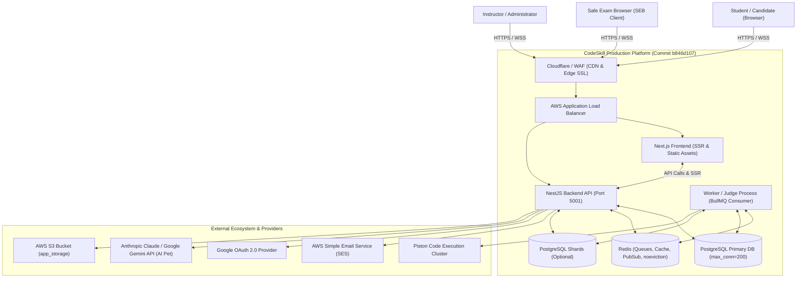
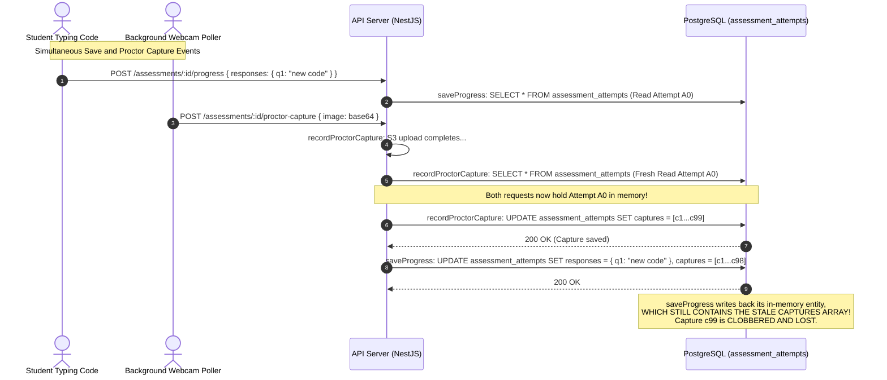

# Reconstructed System Architecture & Technical Analysis (Commit `b846d107`)

**Target Repository:** CodeSkill Platform  
**Commit Inspected:** `b846d107`  
**Auditor:** Principal Software Architect & Distributed Systems Engineer  
**Output Location:** `engineering-audit/`  

---

## 1. System Inventory & Runtime Stack (Post-PR #95)

| Subsystem | Framework / Technology | Version / Runtime | Architectural Pattern |
| :--- | :--- | :--- | :--- |
| **Frontend Application** | Next.js (App Router), React, TailwindCSS, Monaco Editor | Node.js 20.x, Next.js 15.x / React 19 | Hybrid SSR & Client Components, Global Zustand & Context State |
| **Backend API Engine** | NestJS, Express, TypeORM, Passport.js, BullMQ | Node.js 20.x, TypeScript 5.x | Modular Monolith (Dependency Injection, DTO Validation Pipes, Guards) |
| **Primary Relational DB** | PostgreSQL (AWS RDS / Docker) | PostgreSQL 15+ | Relational with Declarative Partitioning & JSONB document columns |
| **Submission Shards** | PostgreSQL (Optional multi-shard) | PostgreSQL 15+ | Tenant/User Sharding with dedicated `SubmissionStore` |
| **Cache, Queues & PubSub** | Redis (ElastiCache / Docker), BullMQ | Redis 7.x | Queue broker for code execution, Socket.IO adapter, Throttle store |
| **Execution Sandboxes** | Piston Execution Engine, Docker CLI | Piston API / Docker Isolation | Ephemeral Container Execution & Resource Cgroup Limiting |
| **Storage & Media** | AWS S3 / Compatible Object Storage | AWS SDK v3 (`@aws-sdk/client-s3`) | Bucket storage for avatars, submissions, proctoring webcam frames |
| **Cloud Infrastructure** | Terraform, AWS (VPC, ALB, ECS/ASG, RDS, ElastiCache) | Terraform >= 1.0 | Infrastructure-as-Code with dev and production environments |

---

## 2. Reconstructed System Architecture & Mermaid Diagrams

### 2.1 System Context Diagram (C4 Level 1)



---

### 2.2 Component Architecture & Failure Propagation Diagram

```mermaid
flowchart TD
    subgraph Compute["Application Compute"]
        API["NestJS API Process"]
        Worker["Judge Worker Process"]
    end

    subgraph State["State & Message Brokers"]
        PG["PostgreSQL Primary DB<br/><b>Constraint:</b> 200 conns on 1GB RAM"]
        Redis["Shared Redis Cluster<br/><b>Constraint:</b> noeviction policy"]
        S3["AWS S3 Bucket<br/><b>Issue:</b> Missing presigner in node_modules"]
    end

    subgraph Sandbox["Execution Sandboxes"]
        Piston["Piston Execution Host<br/><b>Issue:</b> N-times compilation multiplier"]
    end

    API -->|1. Import s3.service.ts| S3
    S3 -.->|Module Not Found TS2307| Fail1["API Fails to Compile / Start!"]

    API -->|2. Concurrent saveProgress & capture| PG
    PG -.->|Un-locked save() clobber| Fail2["Student Code Wiped Out!"]

    API -->|3. Spike in submissions| Worker
    Worker -->|4. Loop test cases| Piston
    Piston -.->|O(N) Compilations| Fail3["Piston 100% CPU Saturation!"]

    Worker -->|5. Queue growth & Cache keys| Redis
    Redis -.->|noeviction OOM| Fail4["Redis Refuses All Writes!"]
```

---

### 2.3 Assessment Concurrency Flow: Why the PR #95 Fix is Incomplete



---

## 3. Single Points of Failure (SPOF) Analysis

1. **Uninstalled S3 Presigner Dependency (NEW SPOF):**
   - The backend cannot start or compile cleanly because `@aws-sdk/s3-request-presigner` is missing from `node_modules`. Any clean deployment or CI build fails at the compile stage.
2. **Shared Single Redis Instance with `noeviction`:**
   - BullMQ persistent queues, login rate limits, and Socket.IO adapters share a single Redis instance configured with `noeviction`. Once memory limits are reached, all authentication and task processing freezes.
3. **Piston Cluster Single Node Saturation:**
   - Stateless Piston instances execute $T$ compilations for a single submission with $T$ test cases. Under 20 concurrent student submissions, Piston is bombarded with 300+ full compiler invocations, saturating host CPU.
4. **RDS PostgreSQL Memory Pressure under 200 Connections:**
   - `terraform/modules/rds/main.tf` raised `max_connections` from 50 to 200 on `db.t4g.micro` (1 GiB RAM). If connections approach 200, PostgreSQL memory consumption ($200 \times \text{work\_mem} + \text{shared\_buffers}$) exceeds 1 GiB, causing Linux Out-Of-Memory (OOM) killer to terminate the PostgreSQL daemon.
