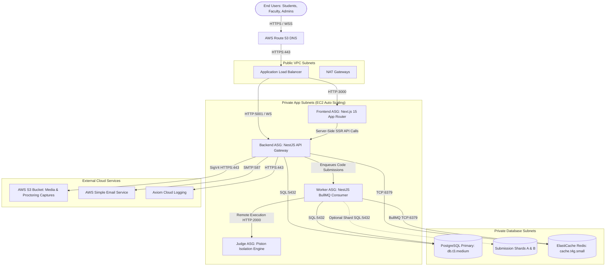
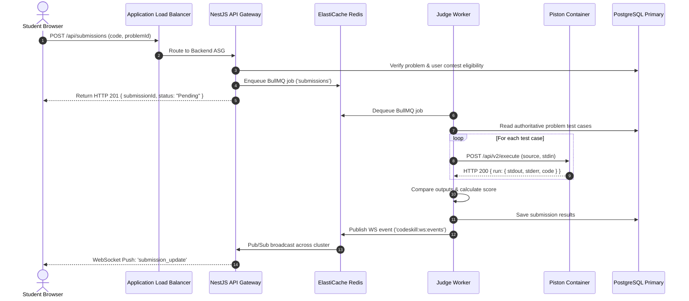

# Independent Pre-Production Engineering Audit: Architecture Analysis

**Target Commit:** `3a3e9671d863e8abd95d19cbc7136c4227476ba8`  
**Discipline:** Principal Software Architect & Distributed Systems Engineer  
**Status:** Complete Independent Evaluation  

---

## 1. System Topology & Architectural Overview

The CodeSkill platform is structured as a decoupled multi-tier architecture designed for competitive programming, university programming assessments, and online contest proctoring. The production architecture deployed in AWS `ap-south-1` is illustrated in the architectural topology diagram below.

---

## 2. Component Tier Breakdown

### 2.1 Frontend Tier (`frontend-v2/`)
- **Framework & Runtime:** Next.js 15.2.4 (App Router), React 19.0.0, Node.js 22 LTS / 24.
- **State Management & UI:** Zustand for workspace and contest state; Tailwind CSS, Radix UI primitives, Lucide icons, Framer Motion animations.
- **Code Editor & Execution Feedback:** Monaco Editor (`@monaco-editor/react`) with syntax highlighting, custom theme injection, and vim keybindings (`monaco-vim`).
- **Communication Protocols:**
  - REST client via `axios` with interceptor-based JWT injection, token rotation, and 429 exponential backoff.
  - WebSockets via `socket.io-client` connecting to `/socket.io` for live contest events, proctoring alerts, and AI generation streaming.
- **SSR & Proxying:** Next.js server components communicate internally with the backend API via `INTERNAL_BACKEND_URL` while client browsers connect via `NEXT_PUBLIC_API_URL`.

### 2.2 Backend API Tier (`backend-nestjs/src/main.ts`)
- **Framework & Architecture:** NestJS 10, Express HTTP platform, modular dependency injection.
- **API Surface:** REST endpoints mounted at `/api/`, OpenAPI Swagger documentation at `/api/docs`.
- **Security & Guards:** Passport JWT (`JwtAuthGuard`), role-based access control (`RolesGuard`), custom `@CurrentUser` decorators, throttler guards (`ThrottlerGuard`).
- **Real-Time Gateway:** `AppGateway` (`@WebSocketGateway`) handling authenticated Socket.IO connections with Redis pub/sub fanout across multiple API instances.

### 2.3 Asynchronous Execution Tier (`backend-nestjs/src/worker.ts`)
- **Process Model:** Dedicated standalone NestJS application context initialized with `PROCESS_ROLE=judge` and `ENABLE_EMBEDDED_JUDGE=false`.
- **Queue System:** BullMQ queue consumer listening on Redis queue `submissions` with concurrency controls, exponential backoff, and job progress reporting.
- **Execution Adapters:** Pluggable execution provider abstraction supporting `piston` (primary production provider), `judge0` (remote provider), and `legacy` (local Docker container runner).

### 2.4 Data & Storage Tier
- **Relational Domain Storage:** AWS RDS PostgreSQL 14 (`db.t3.medium`, Multi-AZ in production).
- **Partitioning:** PostgreSQL declarative range partitioning on high-volume tables (`submissions`, `exam_security_events`, `audit_logs`).
- **Submission Sharding:** Optional horizontal application-level sharding via `SubmissionStore` mapping `userId` hashes to distinct database connection pools.
- **Cache & Pub/Sub:** AWS ElastiCache Redis 7 (`cache.t4g.small`, Redis OSS cluster) managing BullMQ job queues, socket pub/sub synchronization, OTP verification, and rate-limiting counters.
- **Object Storage:** AWS S3 managing user avatars and proctored exam captures signed with AWS SigV4.

---

## 3. Communication Protocols and Boundary Analysis

---

## 4. Single Points of Failure (SPOF) & Architectural Bottlenecks

### 4.1 Redis Single Point of Failure and Resource Contention
- **Observed Architecture:** All application components—BullMQ submission queues, WebSocket broadcast channels, user OTP storage, API rate-limiting buckets, and cached problem queries—share a single ElastiCache Redis cluster.
- **Failure Mode:** In `terraform/modules/redis/main.tf`, the cluster parameter group enforces `maxmemory-policy = noeviction`. If volatile cache data or lingering WebSocket session keys exhaust available memory on the `cache.t4g.small` node, Redis refuses all subsequent write commands (`OOM command not allowed`).
- **Cascade Impact:** When Redis throws an OOM error, BullMQ can no longer insert jobs, OTPs cannot be generated, and all student submissions fail immediately.

### 4.2 Non-Isolated In-Memory Query Processing
- **Observed Architecture:** In `assessments.service.ts` (`getStudentAssessments`), when a student loads their exam catalog, the backend loads every published and ongoing assessment into Node.js V8 memory without SQL-level filtering or pagination.
- **Failure Mode:** Under concurrent exam morning traffic (e.g., 1,500 students opening their dashboard within 60 seconds), 1,500 simultaneous full-table loads and JSONB deserializations saturate Node.js event loop capacity, causing API latency spikes and memory starvation.

### 4.3 Piston Multi-Pass Compilation Amplification
- **Observed Architecture:** In `execution.service.ts`, test cases for compiled languages (C, C++, Java, Rust) are dispatched as independent execution requests to Piston.
- **Failure Mode:** Because Piston executes isolated containers per request, a student submitting a C++ solution evaluated against 25 test cases forces Piston to invoke `g++` 25 times sequentially or in parallel chunks.
- **Amplification Factor:** 100 students submitting during a contest = $100 \times 25 = 2,500$ full compilation cycles. This amplifies CPU utilization by $25\times$ compared to standard judge architectures that compile once and execute the resulting binary across all test cases.

---

## 5. Architectural Cohesion & Coupling Assessment

| Domain / Boundary | Coupling Rating | Cohesion Rating | Evaluation & Technical Debt |
| :--- | :---: | :---: | :--- |
| **API $\leftrightarrow$ Worker** | **Loose** (Healthy) | **High** | BullMQ decouples submission acceptance from evaluation. API returns immediate HTTP 201 and delegates heavy execution to the worker pool. |
| **Worker $\leftrightarrow$ Piston** | **Tight** (Problematic) | **Medium** | Worker depends synchronously on HTTP response from Piston per test case. Network jitter or slow compilation blocks worker concurrency slots. |
| **API $\leftrightarrow$ Database** | **Tight** (Risk) | **Low** | Relational queries mix pure SQL entity mappings with heavy JSONB documents (`responses`, `captures`, `sections`). Updates rewrite entire JSONB columns rather than performing granular attribute updates. |
| **Frontend $\leftrightarrow$ Backend** | **Moderate** (Acceptable) | **High** | API client dynamically resolves base URLs, normalizes `_id`/`id` inconsistencies across MongoDB and PostgreSQL, and provides transparent token refresh. |

---

## 6. Recommendations for Target Architecture

1. **Decouple Queue Storage from Caching:** Provision two distinct Redis clusters in Terraform:
   - `codeskill-redis-queue`: Configured with `maxmemory-policy = noeviction` dedicated exclusively to BullMQ.
   - `codeskill-redis-cache`: Configured with `maxmemory-policy = allkeys-lru` dedicated to volatile query caching and rate limits.
2. **Implement Binary-Reuse Judge Pipeline:** Modify `execution.service.ts` or deploy an intermediate compilation proxy that invokes `piston.compile()` once, stores the compiled binary artifact, and dispatches only binary execution requests with test case inputs.
3. **Database-Driven Audience Filtering:** Replace in-memory JavaScript filtering of assessments with indexed PostgreSQL SQL queries using GIN index containment (`@>`) on target arrays.
