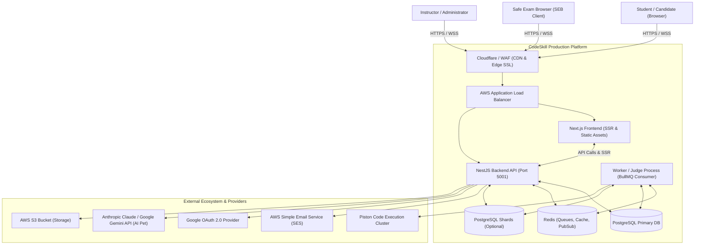
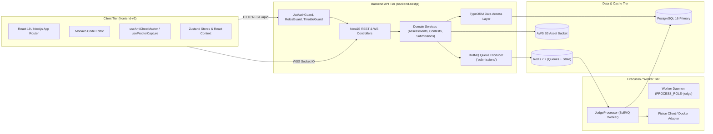
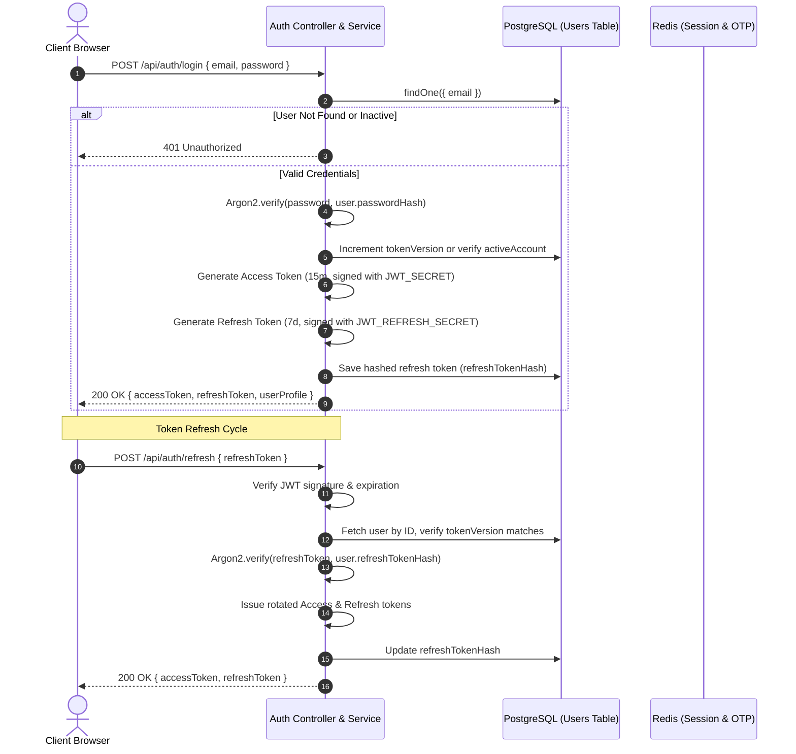
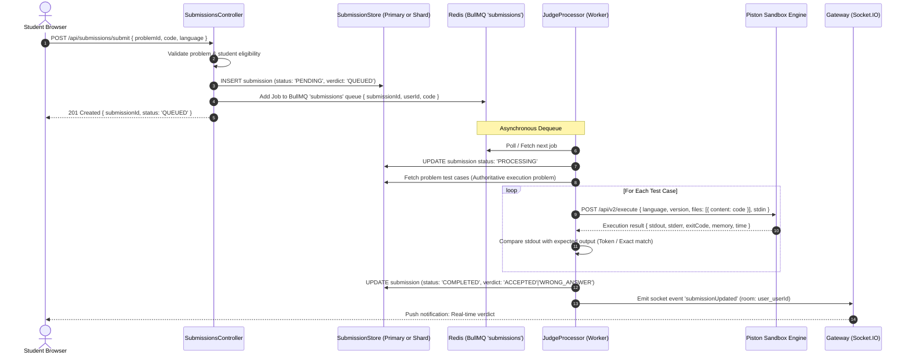
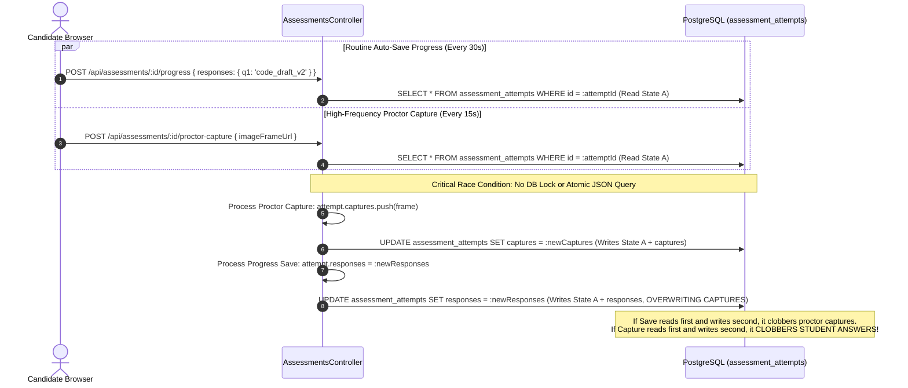
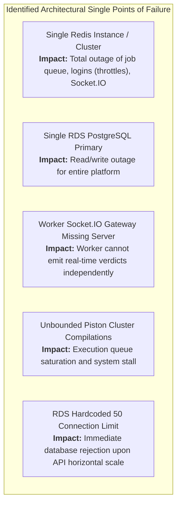

# Reconstructed System Architecture & Technical Analysis

**Target Repository:** CodeSkill Platform  
**Commit Hash:** `2d89bd45`  
**Auditor:** Principal Software Architect & Distributed Systems Engineer  

---

## 1. System Inventory & Runtime Stack

| Subsystem | Framework / Technology | Version / Runtime | Architectural Pattern |
| :--- | :--- | :--- | :--- |
| **Frontend Application** | Next.js (App Router), React, TailwindCSS, Monaco Editor | Node.js 20.x, Next.js 15.x / React 19 | Hybrid SSR & Client Components, Global Zustand & Context State |
| **Backend API Engine** | NestJS, Express, TypeORM, Passport.js, BullMQ | Node.js 20.x, TypeScript 5.x | Modular Monolith (Dependency Injection, DTO Validation Pipes, Guards) |
| **Primary Relational DB** | PostgreSQL (AWS RDS / Docker) | PostgreSQL 15+ | Relational with Declarative Partitioning & JSONB document columns |
| **Submission Shards** | PostgreSQL (Optional multi-shard) | PostgreSQL 15+ | Tenant/User Sharding with dedicated `SubmissionStore` |
| **Cache, Queues & PubSub** | Redis (ElastiCache / Docker), BullMQ | Redis 7.x | Queue broker for code execution, Socket.IO adapter, Throttle store |
| **Execution Sandboxes** | Piston Execution Engine, Docker CLI | Piston API / Docker Isolation | Ephemeral Container Execution & Resource Cgroup Limiting |
| **Storage & Media** | AWS S3 / Compatible Object Storage | AWS SDK v3 | Bucket storage for avatars, submissions, proctoring webcam frames |
| **Cloud Infrastructure** | Terraform, AWS (VPC, ALB, ECS/ASG, RDS, ElastiCache) | Terraform >= 1.0 | Infrastructure-as-Code with dev and production environments |

---

## 2. System Context & Component Architecture

### 2.1 System Context Diagram (C4 Level 1)

---

### 2.2 Component Architecture Diagram (C4 Level 2)

---

## 3. Core Request Lifecycles & Sequence Diagrams

### 3.1 Authentication & Token Lifecycle Flow

---

### 3.2 Submission Processing & Code Judging Sequence

---

### 3.3 Assessment Attempt Concurrency Flow (Revealing Race Conditions)

---

## 4. Single Points of Failure (SPOF) Analysis

1. **Single Redis ElastiCache Instance (No Multi-AZ Failover in Default Dev/Prod):**
   - Redis manages: (1) BullMQ job processing, (2) User session tracking, (3) OTP verification, (4) Throttler rate limiting, and (5) WebSockets pub/sub.
   - If Redis undergoes failover or memory saturation under `noeviction`, all authentication, submission, and notification channels fail simultaneously.
2. **PostgreSQL Connection Pool Sizing Mismatch:**
   - RDS parameter group restricts `max_connections` to 50.
   - API server pool defaults to 50; Judge worker process defaults to 50.
   - Any autoscaling event instantly exhausts PostgreSQL connection slots, bringing down all active transactions with `FATAL: remaining connection slots are reserved for non-replication superuser connections`.
3. **Decoupled Worker Socket.IO Emission:**
   - In production when `PROCESS_ROLE=judge` is deployed as a standalone PM2/Docker service, the NestJS `Gateway` is not attached to an active HTTP/WS listening server. Worker-side verdict push notifications fail to reach connected clients, requiring clients to poll.
4. **Shared Database Entity for Assessment State and Telemetry:**
   - The `assessment_attempts` table stores critical academic records (user answers) alongside high-frequency ephemeral telemetry (`captures` and `violations`). High-frequency proctoring updates lock or overwrite candidate exam submissions.
