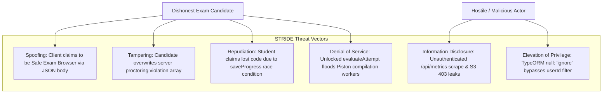
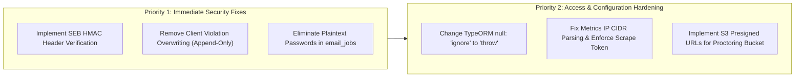

# Application Security Assessment & Threat Model

**Audit Date:** October 18, 2026  
**Audited Target:** CodeSkill Platform  
**Commit:** `2d89bd45`  
**Auditor:** Application Security & Threat Modeling Specialist  

---

## 1. Executive Security Posture & ASVS L2 Evaluation

The CodeSkill security architecture incorporates modern cryptographic algorithms and defensive patterns in several core areas:
- Password hashing uses **Argon2id** (`auth/password.util.ts`).
- Refresh tokens are stored in the database as one-way Argon2 hashes (`refreshTokenHash`), protecting user sessions from database dump exposure.
- JWT tokens enforce an active account check and check against an incrementable `tokenVersion` stored on the user entity, allowing immediate revocation of compromised tokens.
- Strict input validation pipes (`ValidationPipe` with `whitelist: true, transform: true`) prevent mass assignment on incoming request DTOs.

However, an evaluation against **OWASP ASVS (Application Security Verification Standard) v4.0 Level 2** and the **OWASP Top 10 (2021)** reveals critical vulnerabilities in examination integrity, authorization controls, metrics exposure, and credential handling.

### ASVS Level 2 Verification Summary

| ASVS Chapter | Domain | Compliance Status | Key Findings / Gaps |
| :--- | :--- | :---: | :--- |
| **V1** | Architecture, Design & Threat Modeling | **Partial** | Lacks threat model for proctoring bypass and multi-tab race conditions. |
| **V2** | Authentication | **Pass (with exceptions)** | Robust Argon2 hashing and JWT tokenVersion; compromised by plaintext passwords in `email_jobs`. |
| **V3** | Session Management | **Pass** | Stateless short-lived JWT (15m) + hashed refresh token rotation (7d). |
| **V4** | Access Control (Authorization) | **Fail** | TypeORM `null: 'ignore'` creates BOLA risk; SEB client checks bypassable via JSON body. |
| **V5** | Malicious Input Handling | **Pass** | Parameterized TypeORM queries prevent standard SQLi; DTO validation active. |
| **V6** | Cryptography at Rest & Transit | **Fail** | S3 bucket lacks presigned access for proctoring; plaintext passwords stored in `email_jobs`. |
| **V7** | Error Handling & Logging | **Partial** | Conflicting health endpoints and IP filter regex bypass on Prometheus metrics. |
| **V8** | Data Protection & Privacy | **Fail** | Sensitive proctoring webcam frames lack access control; candidate violation tampering permitted. |
| **V14** | Build & Deployment Security | **Pass** | Piston execution runs in sandboxed cgroup environments; Docker isolation in legacy mode. |

---

## 2. STRIDE Threat Model



---

## 3. Deep-Dive Security Vulnerability Dissections

### 3.1 Safe Exam Browser (SEB) Integrity Bypass (ISSUE-SEC-001)

#### Threat Description
The platform provides a feature to enforce the use of **Safe Exam Browser (SEB)**—an open-source locked-down environment that disables multi-monitoring, browser tabs, screenshot tools, and external communication.

#### Vulnerability Analysis
In `backend-nestjs/src/exam-security/exam-security.service.ts`:
```typescript
// Lines 39-44:
const clientType = clientBody.isSEB ? 'SEB' : 'BROWSER';

// Lines 98-102:
return {
  verified: true,
  clientType,
  token: 'simulate-secure-token',
};
```
The server determines whether an incoming connection originates from a genuine SEB instance by checking a boolean in the JSON request body (`clientBody.isSEB`).

The genuine SEB specification requires:
1. The browser sends HTTP header `X-SafeExamBrowser-RequestHash` or `X-SafeExamBrowser-ConfigKeyHash`.
2. The hash is an SHA-256 HMAC of the request URL concatenated with the administrator's secret Browser Exam Key or Config Key.
3. The server independently calculates this hash for the exact requested URL and matches it before allowing access.

Because CodeSkill performs zero header verification and returns a hardcoded static string `'simulate-secure-token'`, any student using standard Google Chrome or a Python script can send `{ "isSEB": true }` to bypass all exam lockdown protections.

---

### 3.2 Client-Side Proctoring Violation Tampering (ISSUE-SEC-002)

#### Vulnerability Analysis
In `backend-nestjs/src/assessments/assessments.service.ts`:
```typescript
// Lines 1917-1926:
const clientViolations = body.violations || [];
const existingViolations = attempt.violations || [];
const violations = clientViolations.length >= existingViolations.length 
  ? clientViolations 
  : existingViolations;
attempt.violations = violations;
await this.attemptRepo.save(attempt);
```
When an assessment is submitted or updated, the server compares the length of the client-supplied `violations` array with the server-recorded `existingViolations`. If the client submits an array of equal or greater length, the client array completely replaces the server-side log.

#### Exploitation Scenario
1. The proctoring system detects severe infractions:
   `existingViolations = ['MULTIPLE_FACES_DETECTED', 'SECONDARY_DEVICE_DETECTED']` (Length = 2).
2. The candidate captures the outgoing HTTP request using an intercepting proxy or browser DevTools.
3. The candidate submits:
   `body.violations = ['TAB_BLUR', 'WINDOW_RESIZED']` (Length = 2).
4. Because `2 >= 2`, the server overwrites its authoritative integrity log, completely erasing the evidence of multiple persons or mobile device usage.

---

### 3.3 Plaintext Temporary Credential Storage in `email_jobs` (ISSUE-SEC-004)

#### Vulnerability Analysis
In `backend-nestjs/src/students/students.service.ts`:
```typescript
// Line 782:
await this.emailJobRepo.save({
  userId: user.id,
  type: 'WELCOME_PASSWORD',
  temporaryPassword: rawTemporaryPassword,
  status: 'PENDING',
});
```
During batch CSV student onboarding, the application generates a random temporary password for each user. Rather than generating a secure one-way password-reset token, the plaintext password is saved into a dedicated column `temporaryPassword` in the PostgreSQL table `email_jobs`.

#### Security Impact
1. Passwords remain readable in the database indefinitely or until manually deleted.
2. Read-only database access, SQL injection in another module, database replica leaks, or operational log dumps immediately expose all candidate passwords.

---

### 3.4 Unauthenticated Prometheus Metrics & IP Filter Bypass (ISSUE-SEC-003)

#### Vulnerability Analysis
In `backend-nestjs/src/observability/metrics/metrics.controller.ts`:
```typescript
// Lines 20-29:
const clientIp = req.ip || req.connection.remoteAddress || '';
const isPrivate = clientIp.includes('10.') || clientIp.includes('172.') || clientIp.includes('192.168.');
if (!isPrivate && scrapeToken !== expectedToken) {
  throw new ForbiddenException('Access denied');
}
```
1. **Flawed IP Validation:** The logic uses `string.includes('10.')`. A public client with IP `210.45.1.2`, `104.28.1.1`, or `172.217.16.206` will satisfy `isPrivate === true`.
2. **Missing Token Guard:** If the administrator has not configured `METRICS_SCRAPE_TOKEN` in the environment, `expectedToken` is `undefined`, and any empty token check passes.

#### Exposed Information
Visiting `/api/metrics` discloses:
- Real-time active database connection count.
- BullMQ queue depths and worker processing rates.
- Total system memory and heap allocations.
- Volume of submitted solutions and error distributions.

---

### 3.5 BOLA Hazard: TypeORM `null: 'ignore'` Configuration (ISSUE-DB-001)

#### Vulnerability Analysis
In `backend-nestjs/src/database/database.module.ts`:
```typescript
// Lines 121-123 & 139-141:
invalidWhereValuesBehavior: {
  null: 'ignore',
}
```
By default, modern TypeORM throws an exception or treats `null` as `IS NULL` when encountering an undefined/null value in a query filter. By setting `null: 'ignore'`, if an endpoint executes:
```typescript
await this.submissionRepo.findOne({ where: { id: submissionId, userId: req.user?.id } });
```
and `req.user?.id` happens to evaluate to `undefined` (e.g., due to an unauthenticated path or guard misconfiguration), TypeORM silently removes `userId` from the WHERE clause, generating:
```sql
SELECT * FROM submissions WHERE id = $1;
```
This converts an authorized resource lookup into an unauthorized Broken Object Level Authorization (BOLA) vulnerability.

---

## 4. Code Execution Sandboxing & Container Isolation

The platform supports two code execution backends:
1. **Piston Backend (`PistonService`):**
   - Connects to an external or isolated Piston instance via HTTP.
   - Piston executes code under unprivileged Linux users with CPU limits, memory limits, process limits, and network isolation.
   - Security Posture: **High**, provided Piston is deployed on an isolated EC2 host outside the VPC database subnets.
2. **Legacy Docker Backend (`DockerExecutor`):**
   - Spawns Docker containers directly via the Docker CLI (`docker run --rm -m 256m --cpus 1 ...`).
   - Requires the backend process to have access to `/var/run/docker.sock`.
   - Security Posture: **High Risk if run in Production.** Direct access to the Docker socket by an application container is equivalent to root access on the host. In production, `CODE_EXECUTION_PROVIDER=piston` must remain mandatory.

---

## 5. Security Remediation Action Plan


