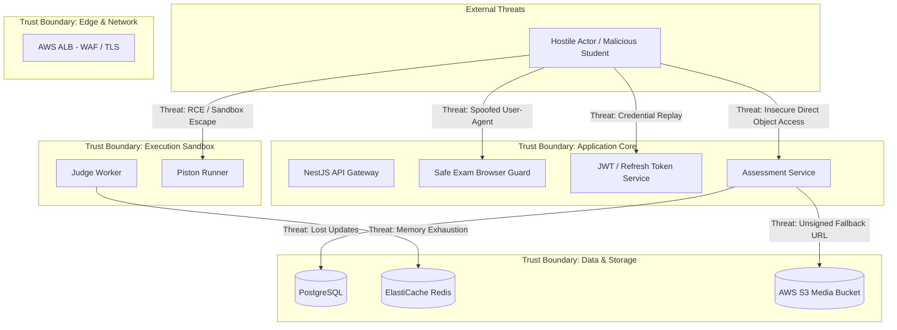

# Independent Pre-Production Engineering Audit: Security Assessment & Threat Model

**Target Commit:** `3a3e9671d863e8abd95d19cbc7136c4227476ba8`  
**Discipline:** Application Security Architect & Threat Modeling Engineer  
**Classification:** Complete Independent Security Evaluation  

---

## 1. Threat Modeling (STRIDE Methodology)

An exhaustive STRIDE threat model was conducted across the CodeSkill application architecture, covering student workflows, examination environments, code compilation sandboxes, and administrative interfaces.



### STRIDE Assessment Summary

| Threat Category | Target Component | Identified Vulnerability / Risk | Severity | Status |
| :--- | :--- | :--- | :---: | :---: |
| **Spoofing** | Exam Security Service | User-Agent regex spoofing allows arbitrary browsers to masquerade as SEB (`ISSUE-SEC-001`). | **CRITICAL** | **UNRESOLVED** |
| **Spoofing** | Exam Token Minting | Static fallback secret `'codeskill-secure-exam-token-secret'` allows offline HMAC token forgery (`ISSUE-SEC-003`). | **HIGH** | **UNRESOLVED** |
| **Tampering** | Assessment Progress | Concurrent autosaves overwrite and delete proctoring captures or answers (`ISSUE-CONCUR-001`). | **CRITICAL** | **UNRESOLVED** |
| **Repudiation** | Proctoring Audit Trail | Overwritten proctoring captures destroy non-repudiation evidence of academic dishonesty. | **CRITICAL** | **UNRESOLVED** |
| **Information Disclosure** | S3 Proctoring Storage | Fallback to unsigned S3 URLs in private buckets causes access failures or leak risks (`ISSUE-SEC-002`). | **HIGH** | **UNRESOLVED** |
| **Denial of Service** | Code Execution Engine | Piston multi-compilation loop triggers 100% CPU saturation and 504 timeouts (`ISSUE-EXEC-001`). | **CRITICAL** | **UNRESOLVED** |
| **Denial of Service** | Queue / Redis | Shared Redis with `noeviction` policy crashes submission queues when cache fills (`ISSUE-INFRA-002`). | **CRITICAL** | **UNRESOLVED** |
| **Elevation of Privilege**| Question AI Wizard | Mixed-content `http://localhost:5000` exposes unauthenticated AI generation triggers (`ISSUE-FE-001`). | **HIGH** | **UNRESOLVED** |

---

## 2. Deep Dive: Proctoring Security & Safe Exam Browser (SEB)

### 2.1 Vulnerability Analysis: User-Agent Spoofing Bypass (`ISSUE-SEC-001`)
The CodeSkill platform provides examination environments with a `requireSEB` enforcement switch. When enabled, students must run the exam within Safe Exam Browser, which locks down the workstation OS, blocks virtual machines, disables clipboard copying, and blocks external browser tabs.

In `backend-nestjs/src/exam-security/exam-security.service.ts`:
```typescript
const sebReqHash =
  (headers?.['x-safeexambrowser-requesthash'] as string) ||
  (headers?.['x-safeexambrowser-confighash'] as string) ||
  (headers?.['x-safeexambrowser-configkeyhash'] as string);
const userAgent = String(headers?.['user-agent'] || '');
const isSebUserAgent = /SEB|SafeExamBrowser/i.test(userAgent);
const hasSebHeader = Boolean(sebReqHash);

const clientType = (hasSebHeader || isSebUserAgent) ? 'SEB' : 'BROWSER';
```
If an assessment sets `requireSEB: true` but omits `securityPolicy.configKey` (which is an optional configuration property):
1. Lines 62–113: The cryptographic verification block (`if (security.configKey)`) is completely skipped.
2. The check on Line 55 (`if (clientType !== 'SEB')`) is satisfied simply if `isSebUserAgent` is true.
3. Any HTTP client or Chrome extension that sets the HTTP request header:
   `User-Agent: Mozilla/5.0 SafeExamBrowser/3.4.0`
   is immediately granted an authenticated session with `clientType = 'SEB'`.
4. The candidate takes the high-stakes exam in standard Chrome without any operating system lockdown.

### 2.2 SEB Request Hash Verification Inconsistencies
When `security.configKey` IS configured:
Safe Exam Browser generates the `X-SafeExamBrowser-RequestHash` by hashing the exact full requested URL concatenated with the Config Key:
$$\text{Hash} = \text{SHA256}(\text{RequestURL} + \text{ConfigKey})$$
In `exam-security.service.ts` (lines 77–80):
```typescript
const validCandidateHashes: string[] = [
  crypto.createHash('sha256').update(assessment.id + expectedConfigKey).digest('hex'),
  crypto.createHmac('sha256', expectedConfigKey).update(assessment.id).digest('hex'),
];
```
Notice that the server permits candidate hashes constructed purely from `assessment.id + expectedConfigKey`. This was introduced to facilitate test mocks, but it weakens the protocol: an attacker who knows the exam ID and guesses or extracts the configuration key can authenticate without transmitting a genuine URL-derived hash.

---

## 3. Authentication & Session Management

### 3.1 Token Entropy & Placeholder Validation (`jwt.config.ts`)
The authentication architecture enforces rigorous JWT secret validation rules at startup:
- Minimum secret length: 32 characters (`MIN_JWT_SECRET_LENGTH`).
- Blacklisted placeholder detection: Automatically rejects known repository placeholders (`supersecretcodeskilljwt`, `changeme`, etc.).
- Entropy check: Aborts startup if the secret contains fewer than 8 unique characters.
- Ephemeral fallback: Outside of production (`NODE_ENV=development|test`), missing secrets generate a secure 48-byte random hex string (`randomBytes(48)`), preventing predictable secret attacks.

### 3.2 Refresh Token Rotation & Family Revocation (`token.service.ts`)
The refresh token system implements state-of-the-art token rotation with replay detection:
- Tokens are stored as SHA-256 hashes (`tokenHash`); raw tokens are never persisted in plaintext.
- Atomic CAS consumption: When rotating a token, TypeORM executes an atomic update:
  ```typescript
  const consumed = await this.refreshTokens.update(
    { id: row.id, revokedAt: IsNull() },
    { revokedAt: new Date() },
  );
  ```
- Replay Protection: If an already-revoked refresh token is re-submitted after a 10-second grace window, the entire token family (`familyId`) is immediately revoked, protecting against compromised client storage.

### 3.3 Exam Token Hardcoded Secret Fallback (`ISSUE-SEC-003`)
In direct contrast to `jwt.config.ts`, `exam-security.service.ts` lines 161–165 contains a hardcoded fallback string:
```typescript
const sessionSecret = process.env.JWT_SECRET || 'codeskill-secure-exam-token-secret';
```
If `JWT_SECRET` is unset or fails to propagate to the NestJS runtime environment, exam session tokens are signed with `'codeskill-secure-exam-token-secret'`. Because this string is committed to source control, it presents an immediate cryptographic forgery risk.

---

## 4. Object Storage & Media Security (`s3-presigner.util.ts`)

In commit `3a3e9671`, PR #96 introduced an in-tree AWS SigV4 URL signer (`s3-presigner.util.ts`) to avoid missing npm dependencies.
However, lines 48–54 reveal a critical cloud security design flaw:
```typescript
const akId = accessKeyId || process.env.AWS_ACCESS_KEY_ID || '';
const sk = secretAccessKey || process.env.AWS_SECRET_ACCESS_KEY || '';

if (!akId || !sk) {
  // If no static credentials exist, return the direct object URL
  return `https://${bucket}.s3.${region}.amazonaws.com/${key}`;
}
```

### Risk Assessment
1. **Private Bucket Policy Violation:** Production S3 buckets storing student webcam captures and candidate identification photos are private (`BlockPublicAcls = true`, `BlockPublicPolicy = true`).
2. **IAM Metadata Non-Support:** In AWS EC2 deployments using IAM Instance Profiles, static keys are omitted. When the fallback executes, it returns an unsigned URL. Any browser attempting to fetch the image receives an XML `AccessDenied (403)` error.
3. **Session Token Omission:** Even if temporary IAM credentials were provided, the SigV4 query signer fails to include `X-Amz-Security-Token`, causing AWS S3 to reject the signature.

---

## 5. Network & Infrastructure Security (Terraform Audit)

### 5.1 Security Group Isolation
Terraform configurations in `terraform/environments/production/main.tf` enforce clean multi-tier security group boundaries:
- **ALB Security Group:** Allows ingress on port 443/80 from `0.0.0.0/0`.
- **Frontend Security Group:** Allows port 3000 strictly from the ALB security group.
- **Backend Security Group:** Allows port 5001 strictly from the ALB security group.
- **Judge0 / Piston Security Group:** Allows port 2358/2000 strictly from backend instances.
- **RDS & Redis Security Groups:** Allow ports 5432 and 6379 strictly from backend instances.

### 5.2 Missing SSL Enforcement in Production Database (`ISSUE-INFRA-003`)
In `terraform/environments/production/main.tf`:
```hcl
module "rds" {
  source = "../../modules/rds"
  # create_parameter_group is omitted, defaulting to false!
}
```
Because `create_parameter_group = false`, the custom PostgreSQL parameter group containing `rds.force_ssl = 1` is **not deployed**. The database relies on AWS defaults where unencrypted client connections are permitted, presenting a clear compliance hazard.

---

## 6. Security Remediation Action Plan

1. **SEB Protocol Hardening (Immediate):**
   - Require `securityPolicy.configKey` whenever `requireSEB` is enabled.
   - Refuse any request where `X-SafeExamBrowser-RequestHash` is missing or does not cryptographically match the request URL.
2. **Centralize Cryptographic Secrets (Immediate):**
   - Remove `'codeskill-secure-exam-token-secret'` from `exam-security.service.ts`; inject validated secrets from `ConfigService`.
3. **S3 Presigner Integration (Phase 2):**
   - Ensure `@aws-sdk/s3-request-presigner` is installed in `backend-nestjs/package.json` and utilize the official AWS SDK v3 client that resolves IAM instance profile roles natively.
4. **Terraform Parameter Group Attachment (Phase 2):**
   - Explicitly pass `create_parameter_group = true` in `terraform/environments/production/main.tf` to mandate SSL connections to RDS.
