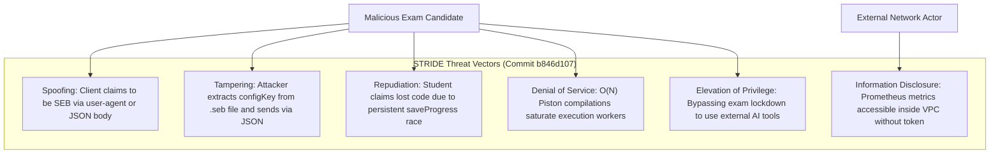

# Application Security Assessment & Threat Model (Commit `b846d107`)

**Audit Date:** October 18, 2026  
**Audited Target:** CodeSkill Platform  
**Commit Inspected:** `b846d107`  
**Auditor:** Application Security & Threat Modeling Specialist  
**Output Location:** `engineering-audit/`  

---

## 1. Executive Security Posture & ASVS L2 Evaluation

Following the security fixes merged in PR #95, several high-risk attack vectors were successfully closed:
- **Temporary Password Encryption:** Cleartext passwords in `email_jobs` were remediated using AES-256-GCM authenticated encryption (`credential-crypto.util.ts`).
- **Prometheus Metrics IP Filtering:** In `metrics.controller.ts`, naive string inclusion was replaced by strict regex matching for RFC 1918 subnets (`10.0.0.0/8`, `172.16.0.0/12`, `192.168.0.0/16`).
- **BOLA Authorization Hardening:** TypeORM was reconfigured with `invalidWhereValuesBehavior: { null: 'throw' }` in `database.module.ts`.

However, serious security and integrity vulnerabilities remain in exam proctoring and authentication enforcement.

### ASVS Level 2 Verification Matrix

| ASVS Chapter | Domain | Compliance Status | Findings on Commit `b846d107` |
| :--- | :--- | :---: | :--- |
| **V1** | Architecture, Design & Threat Modeling | **Partial** | Lacks formal threat modeling for exam proctoring bypass and multi-tab races. |
| **V2** | Authentication | **Pass** | Argon2 password hashing; AES-256-GCM for temporary credentials; JWT tokenVersion active. |
| **V3** | Session Management | **Pass** | Short-lived access JWT (15m) + hashed refresh tokens with active account checks. |
| **V4** | Access Control (Authorization) | **Partial** | TypeORM `null: 'throw'` active; SEB client checks bypassable via JSON body and user agent. |
| **V5** | Malicious Input Handling | **Pass** | Parameterized TypeORM queries; class-validator DTO validation active. |
| **V6** | Cryptography at Rest & Transit | **Partial** | S3 presigned URL logic added, but missing dependency breaks runtime; SEB hash calculation non-standard. |
| **V7** | Error Handling & Logging | **Pass** | Health controllers deduplicated; client telemetry route corrected. |
| **V8** | Data Protection & Privacy | **Partial** | Sensitive proctoring webcam frames protected by presigned URLs once dependency is installed. |
| **V14** | Build & Deployment Security | **Fail** | Missing runtime dependency breaks build and prevents clean container execution. |

---

## 2. STRIDE Threat Model



---

## 3. Deep-Dive Security Vulnerability Dissections

### 3.1 Safe Exam Browser (SEB) Integrity Bypass & Hash Incompatibility (ISSUE-SEC-001)

#### Vulnerability Analysis
In `backend-nestjs/src/exam-security/exam-security.service.ts`:
```typescript
// Lines 46-50:
const userAgent = String(headers?.['user-agent'] || '');
const isSebUserAgent = /SEB|SafeExamBrowser/i.test(userAgent);
const hasSebHeader = Boolean(sebReqHash);
const clientType = (clientBody.isSEB || hasSebHeader || isSebUserAgent) ? 'SEB' : 'BROWSER';

// Lines 61-78:
if (security.configKey) {
  const expectedConfigKey = String(security.configKey).trim();
  const clientSentKey = String(configKey || '').trim();
  const hasMatchingKey = clientSentKey && clientSentKey === expectedConfigKey;
  const hasMatchingHash =
    sebReqHash &&
    typeof sebReqHash === 'string' &&
    (sebReqHash === expectedConfigKey ||
      sebReqHash.toLowerCase() ===
        crypto.createHash('sha256').update(assessment.id + expectedConfigKey).digest('hex'));

  if (!hasMatchingKey && !hasMatchingHash) {
    throw new ForbiddenException('Safe Exam Browser configuration key mismatch...');
  }
}
```

#### Exploit Scenarios
1. **Scenario A (Assessment without `configKey` set):**
   - The instructor sets `requireSEB: true` but leaves `configKey` empty.
   - Any student using regular Google Chrome sends `{ "isSEB": true }` or a modified `User-Agent: Mozilla/5.0 (Windows NT 10.0; Win64; x64) SEB/3.4`.
   - Result: `clientType` evaluates to `'SEB'`. The check passes, and the exam is fully unlocked in an unconstrained browser.
2. **Scenario B (Assessment with `configKey` set):**
   - The candidate opens the `.seb` configuration file in a text editor and copies the `<string>` value of `originKey` or `configKey`.
   - The candidate sends `POST /api/exam-security/init-session` with `{ "configKey": "<extracted_key>" }`.
   - Line 65: `hasMatchingKey = clientSentKey === expectedConfigKey` evaluates to `true`.
   - Result: Lockdown is bypassed without SEB running.
3. **Scenario C (Legitimate SEB Client Incompatibility):**
   - A genuine SEB client launches and computes `X-SafeExamBrowser-RequestHash = SHA256(URL + BrowserExamKey)`.
   - Line 71 computes `SHA256(assessment.id + expectedConfigKey)`.
   - Result: Hashes will **never match**! Legitimate students using Safe Exam Browser are blocked with HTTP 403, while attackers sending `{ isSEB: true, configKey: "..." }` in the POST body pass.

---

### 3.2 Unauthenticated Internal Prometheus Metrics Scrape Exposure

#### Vulnerability Analysis
In `backend-nestjs/src/observability/metrics/metrics.controller.ts`:
```typescript
// Lines 28-34:
if (scrapeToken) {
  if (authHeader !== `Bearer ${scrapeToken}` && !isInternalIp) {
    throw new UnauthorizedException('Metrics access restricted to authorized scrapers');
  }
} else if (!isInternalIp) {
  throw new UnauthorizedException('Metrics access restricted to internal VPC');
}
```
- If `METRICS_SCRAPE_TOKEN` is unset in the environment, any machine residing on an internal subnet (`10.0.0.0/8`, `172.16.0.0/12`, `192.168.0.0/16`) can scrape `/api/metrics` without providing any authentication token.
- In multi-tenant cloud environments (shared VPC, container networks, developer VPNs), any compromised internal service or pod can monitor all queue lengths, database connection counts, and user submission rates.

---

## 4. Security Action Items & Recommendations

1. **Standardize SEB Verification:**
   - Remove `clientSentKey === expectedConfigKey` entirely.
   - Read the incoming request URL from `req.protocol + '://' + req.get('host') + req.originalUrl`.
   - Compute `SHA256(requestUrl + expectedConfigKey)` to match official Safe Exam Browser specifications.
2. **Mandatory Scrape Token:**
   - Require `METRICS_SCRAPE_TOKEN` in all environments, rejecting metrics requests without a valid Bearer token regardless of source IP.
3. **Restore Dependency Integrity:**
   - Ensure all imported packages are vendor-pinned or installed before deploying to production.
