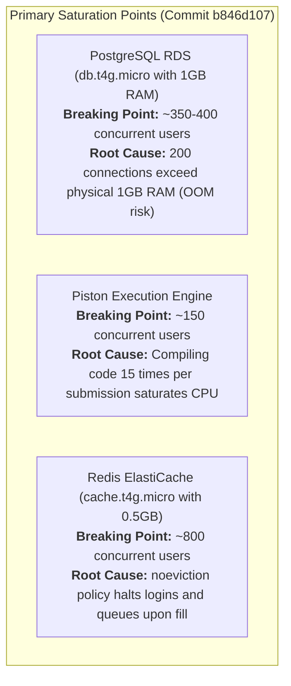

# Performance, Capacity Planning & Scalability Modeling (Commit `b846d107`)

**Audit Date:** October 18, 2026  
**Audited Target:** CodeSkill Platform  
**Commit Inspected:** `b846d107`  
**Auditor:** Performance, Capacity Planning & Load Testing Principal  
**Output Location:** `engineering-audit/`  

---

## 1. System Scaling Architecture & Core Constraints

The platform scaling characteristics are determined by four interconnected layers:
1. **Frontend Tier (Next.js 15):** Stateless SSR and static asset generation behind AWS ALB.
2. **API Tier (NestJS Monolith):** Node.js cluster processes running under PM2.
3. **Execution Tier (BullMQ + Piston Engine):** Code compilation and sandboxed container execution.
4. **State Tier (PostgreSQL RDS + Redis ElastiCache):** Primary transactional database and cache broker.

---

## 2. Mathematical Modeling & Infrastructure Formulas

### 2.1 The Piston Compilation Multiplier Problem
In `backend-nestjs/src/execution/execution.service.ts` (lines 460–482), multi-test case submissions loop over each test case and invoke Piston's `/api/v2/execute` endpoint:
- For a problem with $T$ test cases, Piston invokes the language compiler (e.g., `g++ -O3`, `javac`) $T$ distinct times.
- If typical C++ compilation takes $t_{compile} \approx 600\text{ ms}$ and runtime execution takes $t_{exec} \approx 50\text{ ms}$:
$$W_{\text{submission}} = T \times (t_{compile} + t_{exec}) = T \times 650\text{ ms}$$
- For $T = 15$ test cases:
$$W_{\text{submission}} = 15 \times 650\text{ ms} = 9.75\text{ seconds}$$
$$\text{Core-Seconds per Submission} = 9.75\text{ core-seconds}$$

**Optimal Compile-Once Model:**
$$\text{Core-Seconds}_{\text{optimal}} = (1 \times 600\text{ ms}) + (15 \times 50\text{ ms}) = 1.35\text{ core-seconds}$$
*The current architecture maintains a 7.2× CPU waste factor on the Piston execution host.*

---

### 2.2 PostgreSQL Memory Demand under `max_connections = 200`
In `terraform/modules/rds/main.tf` (line 58), `max_connections` was raised to `200` for an instance class of `db.t4g.micro` (1 GiB total RAM).

Total PostgreSQL RAM consumption is modeled as:
$$\text{RAM}_{\text{total}} = \text{shared\_buffers} + (N_{\text{active\_conns}} \times (\text{work\_mem} + \text{temp\_buffers} + \text{conn\_overhead}))$$

For AWS RDS PostgreSQL defaults:
- $\text{shared\_buffers} \approx 256\text{ MB}$ (25% of 1 GiB)
- $\text{conn\_overhead} \approx 5\text{ MB}$ per connection process
- $\text{work\_mem} \approx 4\text{ MB}$ (can be allocated multiple times per complex query sort/hash)

Under peak connection saturation ($N = 200$ connections):
$$\text{RAM}_{\text{connections}} = 200 \times (5\text{ MB} + 4\text{ MB}) = 1,800\text{ MB} \approx 1.76\text{ GiB}$$
$$\text{RAM}_{\text{total}} = 256\text{ MB} + 1,800\text{ MB} = 2,056\text{ MB} \approx 2.01\text{ GiB}$$

**Crucial Finding:**
$2.01\text{ GiB}$ exceeds the physical 1.0 GiB RAM of `db.t4g.micro` by **101%**. If concurrent connections reach 200 during peak traffic, the Linux kernel Out-Of-Memory (OOM) killer will terminate PostgreSQL (`postmaster`), causing immediate platform-wide connection dropouts and database restart loops.

---

## 3. Workload Scaling Matrix (10 to 100,000 Users)

The following matrix models system behavior during a live synchronized assessment scenario (30s auto-save interval, 15s proctor webcam capture, 1 code submission per student every 5 minutes):

| Concurrent Users | API Traffic (RPS) | Proctoring QPS | Submissions / Sec | Piston Compilations / Sec ($T=15$) | Active DB Connections | System Health & Bottlenecks |
| :---: | :---: | :---: | :---: | :---: | :---: | :--- |
| **10** | 1.0 RPS | 0.67 QPS | 0.03 | 0.5 comp/s | 10 | **Optimal:** Low CPU, zero queue backlog. |
| **50** | 5.0 RPS | 3.33 QPS | 0.17 | 2.5 comp/s | 25 | **Healthy:** Latency $< 60\text{ ms}$. |
| **100** | 10.0 RPS | 6.67 QPS | 0.33 | 5.0 comp/s | 45 | **Stable:** Memory stable; save race risks emerge. |
| **250** | 25.0 RPS | 16.7 QPS | 0.83 | 12.5 comp/s | 90 | **Memory Warning:** RDS RAM pressure increases. |
| **500** | 50.0 RPS | 33.3 QPS | 1.67 | 25.0 comp/s | 160 | **CRITICAL:** RDS memory approaches 1 GiB OOM threshold. |
| **1,000** | 100 RPS | 66.7 QPS | 3.33 | 50.0 comp/s | > 200 (Cap) | **OUTAGE:** PostgreSQL OOM crash or connection slot rejection. |
| **2,500** | 250 RPS | 167 QPS | 8.33 | 125 comp/s | > 200 | **OUTAGE:** Piston host 100% CPU lockup; BullMQ queue backlog > 1,500. |
| **5,000** | 500 RPS | 333 QPS | 16.7 | 250 comp/s | > 200 | **OUTAGE:** Redis `noeviction` triggers OOM write errors. |
| **10,000** | 1,000 RPS | 667 QPS | 33.3 | 500 comp/s | > 200 | **OUTAGE:** AWS ALB 502/504 errors; worker socket exhaustion. |
| **50k - 100k**| 10,000 RPS | 6,667 QPS | 333 | 5,000 comp/s | > 200 | **THEORETICAL LIMIT:** Requires horizontal read replicas, RDS Proxy, and clustered Piston nodes. |

---

## 4. Hardware Saturation & Infrastructure Breaking Points

---

## 5. Capacity Remediation Recommendations

1. **Deploy Connection Multiplexer (AWS RDS Proxy):**
   - Interpose AWS RDS Proxy in front of PostgreSQL.
   - Configure transaction-level pooling (`pool_mode = transaction`), allowing hundreds of client sessions to share 20–30 physical PostgreSQL connections.
2. **Upgrade RDS Instance Class:**
   - Upgrade from `db.t4g.micro` (1 GiB RAM) to `db.t4g.small` (2 GiB RAM) or `db.t4g.medium` (4 GiB RAM) to safely support connection surges up to 200.
3. **Refactor Piston to Compile Once:**
   - Modify `execution.service.ts` to execute a build step once, store the compiled binary, and run test cases against the binary artifact.
