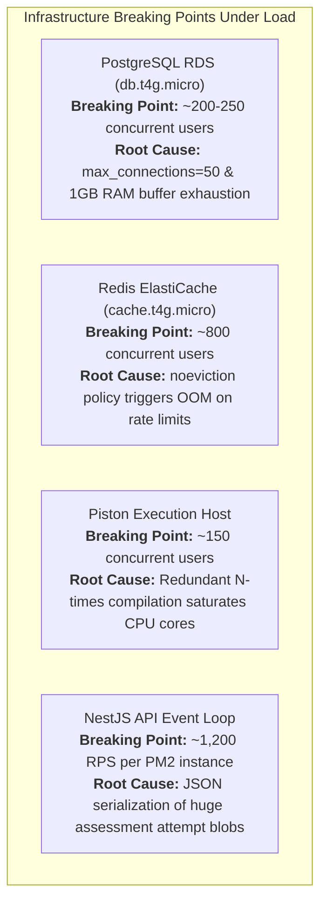

# Performance, Capacity Planning & Scalability Modeling

**Audit Date:** October 18, 2026  
**Audited Target:** CodeSkill Platform  
**Commit:** `2d89bd45`  
**Auditor:** Performance, Capacity Planning & Load Testing Principal  

---

## 1. System Scaling Architecture & Core Constraints

The platform performance envelope is dictated by four distinct computational tiers:
1. **Frontend Tier (Next.js / SSR & Static Assets):** Stateless; scalable behind ALB/Cloudflare.
2. **API Tier (NestJS Monolith):** Node.js single-threaded event loop running under PM2 in cluster mode.
3. **Execution Tier (BullMQ + Piston Engine):** Asynchronous code compilation and execution workers.
4. **State Tier (PostgreSQL RDS + Redis ElastiCache):** Primary transactional database and cache/broker.

---

## 2. Mathematical Modeling & Throughput Formulations

### 2.1 Concurrency & Service Demand (Little's Law)
By Little's Law, the average number of concurrent requests in the system $L$ is:
$$L = \lambda \times W$$
where:
- $\lambda$ = Arrival rate (Requests Per Second, RPS)
- $W$ = Mean response latency (seconds)

For the API tier with $N_{proc}$ Node.js cluster processes and an optimal concurrency limit per process $C_{proc} \approx 50$ (to maintain event loop lag $< 20\text{ ms}$):
$$L_{\max} = N_{proc} \times 50$$
$$\lambda_{\max} = \frac{N_{proc} \times 50}{W}$$

### 2.2 The Piston Compilation Multiplier Problem
For a student submitting code to a problem with $T$ test cases:
- In the current implementation (`execution.service.ts` L460-482), Piston re-invokes the compiler for *each* test case:
$$C_{\text{compiles}} = N_{\text{submits}} \times T$$
- If a typical C++ / Java compilation requires $t_{compile} \approx 600\text{ ms}$ of dedicated CPU time and $t_{exec} \approx 50\text{ ms}$ of runtime:
$$W_{\text{submission}} = T \times (t_{compile} + t_{exec}) = T \times 650\text{ ms}$$
- For a problem with $T = 20$ test cases:
$$W_{\text{submission}} = 20 \times 650\text{ ms} = 13\text{ seconds per submission}$$
- Total CPU core seconds consumed per submission:
$$\text{Core-Seconds} = 20 \times 0.65\text{s} = 13.0\text{ core-seconds}$$

**Optimized Batch Model (Compile Once):**
$$\text{Core-Seconds}_{\text{optimized}} = (1 \times 0.6\text{s}) + (20 \times 0.05\text{s}) = 1.6\text{ core-seconds}$$
*The current implementation creates an 8.1× CPU amplification factor on the execution cluster.*

---

## 3. Workload Scaling Matrix (10 to 100,000 Users)

The following model evaluates platform behavior during a synchronized coding assessment or contest scenario (30s autosave interval, 15s proctor webcam capture, 1 submission per user every 5 minutes).

| Concurrent Users | API Traffic (Req/sec) | Proctoring QPS | Submission Rate (Sub/sec) | Piston Compilations/sec ($T=15$) | Database Connections Required | System Status & Bottlenecks |
| :---: | :---: | :---: | :---: | :---: | :---: | :--- |
| **10** | 1.0 RPS | 0.67 QPS | 0.03 Sub/s | 0.5 comp/s | 10 | **Optimal:** Low CPU, zero queuing. |
| **50** | 5.0 RPS | 3.33 QPS | 0.17 Sub/s | 2.5 comp/s | 20 | **Healthy:** Response latency $< 50\text{ ms}$. |
| **100** | 10.0 RPS | 6.67 QPS | 0.33 Sub/s | 5.0 comp/s | 35 | **Borderline:** First signs of assessment save race conditions. |
| **250** | 25.0 RPS | 16.7 QPS | 0.83 Sub/s | 12.5 comp/s | 50 (RDS Cap) | **CRITICAL FAILURE:** RDS hits 50 connections; queries stall. |
| **500** | 50.0 RPS | 33.3 QPS | 1.67 Sub/s | 25.0 comp/s | > 80 | **OUTAGE:** PostgreSQL rejects connections (`FATAL: remaining slots`). |
| **1,000** | 100 RPS | 66.7 QPS | 3.33 Sub/s | 50.0 comp/s | > 150 | **OUTAGE:** Piston CPU saturation (50 cores needed); Redis memory pressure. |
| **2,500** | 250 RPS | 167 QPS | 8.33 Sub/s | 125 comp/s | > 300 | **OUTAGE:** BullMQ queue depths exceed 1,000; Socket timeouts. |
| **5,000** | 500 RPS | 333 QPS | 16.7 Sub/s | 250 comp/s | > 500 | **OUTAGE:** In-memory Pet rate limiter memory exhaustion. |
| **10,000** | 1,000 RPS | 667 QPS | 33.3 Sub/s | 500 comp/s | > 1,000 | **OUTAGE:** S3 request rate limits on single bucket prefix; ALB 502/504s. |
| **50k - 100k** | 10,000 RPS | 6,667 QPS | 333 Sub/s | 5,000 comp/s | > 5,000 | **THEORETICAL LIMIT:** Requires horizontal sharding, multi-AZ Piston clusters, Redis clustering. |

---

## 4. Hardware Saturation & Infrastructure Breaking Points

### 4.1 PostgreSQL RDS (`db.t4g.micro`): 250 Users Max
- **Constraint:** `terraform/modules/rds/main.tf` explicitly configures `max_connections = 50`.
- **Failure Mode:** Each backend instance (API and Judge) creates connection pools up to `DB_POOL_MAX = 50`. With just 2 instances running, total connection demand is 100. At 250 active concurrent users, burst queries consume all 50 slots, throwing immediate 500 errors to users.

### 4.2 Redis Cluster (`cache.t4g.micro`): 800 Users Max
- **Constraint:** 0.5 GiB available memory under `maxmemory-policy: noeviction`.
- **Failure Mode:** BullMQ stores jobs, results, and logs. High submission volume plus high-frequency rate-limiting keys quickly exceed 500 MB. Redis immediately enters read-only mode, rejecting all new submissions and logins with `OOM command not allowed`.

### 4.3 Piston Compilation Cluster: 150 Users Max
- **Constraint:** Piston instances on typical cloud VMs (e.g., 4 vCPU / 8 GB RAM).
- **Failure Mode:** A 4 vCPU VM can sustain approximately 6–8 concurrent C++ compilations before CPU throttling occurs. Because every test case triggers a recompilation, a single submission with 15 test cases completely monopolizes the Piston instance for 9 seconds. 10 concurrent submissions create an instantaneous 90-second queue backlog.

---

## 5. Capacity Remediation Blueprint

1. **Deploy Connection Pooling (PgBouncer / AWS RDS Proxy):**
   - Interpose PgBouncer or RDS Proxy between the application and PostgreSQL.
   - Configure transaction-level pooling (`pool_mode = transaction`), allowing 500 application client connections to share 25 physical PostgreSQL connections.
2. **Optimize Piston Compilation Pipeline:**
   - Refactor `execution.service.ts` to implement a two-stage compile-then-run pipeline.
   - For compiled languages, invoke Piston once with a build script, retain the compiled binary, and execute subsequent test cases against the binary artifact.
3. **Partition & Evict Redis Workloads:**
   - Isolate BullMQ queues to a dedicated persistent Redis instance.
   - Set `maxmemory-policy: volatile-lru` on the caching and rate-limiting Redis instance.
