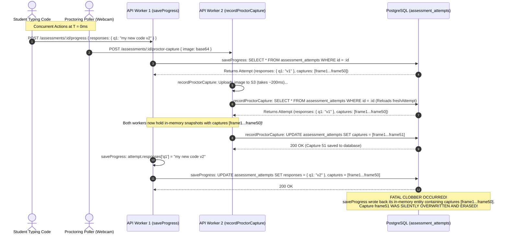
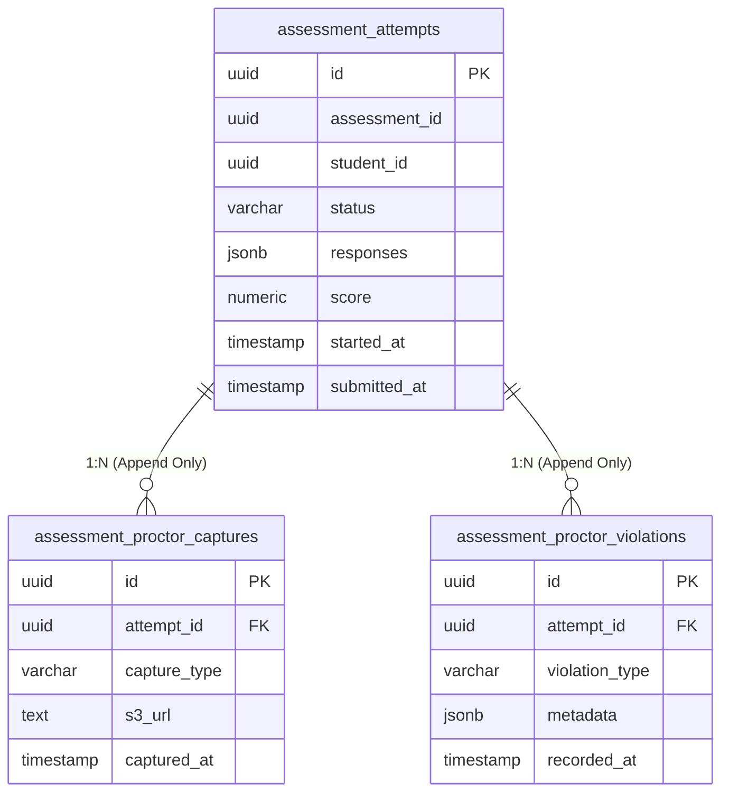

# Concurrency, Race Conditions & Data Integrity Audit (Commit `b846d107`)

**Audit Date:** October 18, 2026  
**Audited Target:** CodeSkill Platform Data Access Layer  
**Commit Inspected:** `b846d107`  
**Auditor:** Distributed Systems & Concurrency Engineer  
**Output Location:** `engineering-audit/`  

---

## 1. Executive Summary: The Illusion of Concurrency Safety in PR #95

In commit `b846d107` (PR #95), the engineering team introduced two notable concurrency improvements:
1. **Discussion Voting & Replies (`discussions.service.ts`):** Wrapped in `this.discussionRepo.manager.transaction` with `lock: { mode: 'pessimistic_write' }`, successfully preventing lost updates on upvotes and downvotes.
2. **Assessment Submission Locking (`assessments.service.ts`):** Implemented an atomic CAS transition (`UPDATE assessment_attempts SET status = 'evaluating' WHERE id = :id AND status = 'in_progress'`), mitigating duplicate concurrent evaluations.

However, the most dangerous data integrity flaw in the system—**the race condition between candidate autosaves and background proctoring captures**—was only superficially patched and remains an active threat to candidate exam data.

---

## 2. In-Depth Analysis: The Incomplete `recordProctorCapture` Reload

### The Attempted Fix in PR #95
In `backend-nestjs/src/assessments/assessments.service.ts` (lines 2383–2390):
```typescript
// Reload fresh attempt state after S3 upload so any student responses saved while upload was in flight are preserved
const freshAttempt = await this.attemptRepo.findOne({
  where: { id: attempt.id },
});
const targetAttempt = freshAttempt || attempt;
const captures = Array.isArray((targetAttempt as any).captures) ? (targetAttempt as any).captures : [];
(targetAttempt as any).captures = [...captures, { type: dto.type, url, objectKey, timestamp: capturedAt, filename: dto.filename }];
await this.attemptRepo.save(targetAttempt);
```

### Why the Flaw Persists (The Bi-Directional Race)
The attempted fix assumes that conflicts only happen *during* the S3 upload. It reloads `attempt` before saving `targetAttempt`.
However, it ignores that **`saveProgress` is also executing concurrently and does NOT reload or lock anything**:

```typescript
// In saveProgress (lines 1531-1638):
const attempt = await this.attemptRepo.findOne({
  where: {
    assessmentId: assessment.id,
    studentId,
    status: 'in_progress',
  },
});
// ... maps responses ...
attempt.responses = [...previousResponses.filter(...), ...updatedResponses];
// ...
await this.attemptRepo.save(attempt); // <--- OVERWRITES THE ENTIRE ROW IN POSTGRESQL!
```

### The Interleaved Execution Sequence



### The Reverse Clobber Scenario (Student Answer Erased)
If the timing shifts slightly:
1. `saveProgress` loads `attempt` at $T_0$.
2. `recordProctorCapture` uploads to S3, loads `freshAttempt` at $T_1$, and starts processing.
3. `saveProgress` calls `save(attempt)` at $T_2$, saving candidate answers.
4. `recordProctorCapture` calls `save(targetAttempt)` at $T_3$, writing back its snapshot from $T_1$.
5. **Student code answers saved at $T_2$ are overwritten back to the $T_1$ state! Student work is permanently lost.**

---

## 3. The Root Architectural Flaw: Overloaded Entity Design

The persistence tier violates single-responsibility data modeling:
- **`responses`:** Critical candidate academic work (high business value, modified by student).
- **`captures`:** High-frequency binary/telemetry logs (appended every 15s by background proctoring).
- **`violations`:** Append-only disciplinary audit logs.

Combining these three independent streams into single JSONB columns on one PostgreSQL table row creates unavoidable write skew under standard TypeORM `repository.save()` operations.

---

## 4. Architectural Remediation: Full Entity Decomposition



### Implementation Rules:
1. **Dedicated Child Tables:**
   - Proctor captures and violations must be stored in separate child tables.
   - Adding a capture or recording a violation becomes a pure `INSERT INTO assessment_proctor_captures (...)` statement that never touches or updates `assessment_attempts`.
2. **Atomic SQL for `saveProgress`:**
   - In `saveProgress`, never execute `repo.save(entity)`.
   - Execute a targeted atomic update query:
     ```sql
     UPDATE assessment_attempts
     SET responses = $1, time_spent_seconds = $2, updated_at = NOW()
     WHERE id = $3 AND status = 'in_progress';
     ```
   - This mathematically isolates student code saves from any concurrent proctoring activity.
