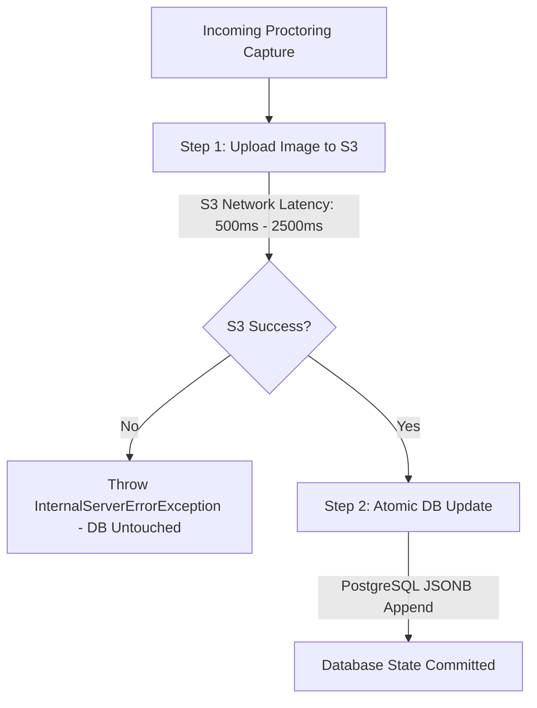

# Independent Pre-Production Engineering Audit: Concurrency & Data Integrity

**Target Commit:** `3a3e9671d863e8abd95d19cbc7136c4227476ba8`  
**Discipline:** Distributed Systems, Concurrency and Data Integrity Engineer  
**Classification:** Concurrency Hazard & Race Condition Verification  

---

## 1. Concurrency Timeline: Lost Update Hazard (`ISSUE-CONCUR-001`)

The most dangerous concurrency hazard in CodeSkill occurs between student answer autosaves (`saveProgress`) and background proctoring image uploads (`recordProctorCapture`).

```mermaid
sequenceDiagram
    autonumber
    actor Student as Student Client
    participant API1 as API Process 1 (Capture)
    participant S3 as AWS S3 Storage
    participant API2 as API Process 2 (Autosave)
    participant DB as PostgreSQL Database

    Note over Student, DB: Student is typing code; periodic webcam snapshot triggers
    Student->>API1: POST /assessments/:id/proctor-capture (base64 image)
    API1->>DB: findOne(attempt) -> loads Attempt v1 (responses: ["Ans A"], captures: [])
    API1->>S3: uploadBase64Image() [Network I/O takes 1200ms]
    
    critical Concurrent Autosave
        Student->>API2: PATCH /assessments/:id/save-progress (responses: ["Ans B"])
        API2->>DB: findOne(attempt) -> loads Attempt v1
        API2->>API2: targetAttempt.responses = ["Ans B"]
        API2->>DB: attemptRepo.save(targetAttempt) -> COMMITS Attempt v2 (responses: ["Ans B"])
    end

    S3-->>API1: S3 Upload Complete (URL returned)
    API1->>DB: findOne(attempt) -> loads Attempt v2
    Note over API1: If API1 loaded attempt right before API2 saved, or if concurrent:
    API1->>API1: Appends new capture to stale captures array
    API1->>DB: attemptRepo.save(targetAttempt) -> OVERWRITES row!
    Note over DB: CRITICAL DATA LOSS: Responses overwritten with ["Ans A"] OR Capture lost!
```

---

## 2. Deep Dive: Race Conditions in `assessments.service.ts`

### 2.1 The Read-Modify-Write Flaw
In `backend-nestjs/src/assessments/assessments.service.ts`:
```typescript
// recordProctorCapture (Lines 2397–2405):
const freshAttempt = await this.attemptRepo.findOne({ where: { id: attempt.id } });
const targetAttempt = freshAttempt || attempt;
const captures = Array.isArray((targetAttempt as any).captures) ? (targetAttempt as any).captures : [];
const updatedCaptures = [...captures, { type: dto.type, url, objectKey, timestamp: capturedAt }];
(targetAttempt as any).captures = updatedCaptures;
await this.attemptRepo.save(targetAttempt);

// saveProgress (Lines 1640–1651):
const freshAttempt = await this.attemptRepo.findOne({ where: { id: attempt.id } });
const targetAttempt = freshAttempt || attempt;
targetAttempt.responses = attempt.responses;
targetAttempt.timeSpentSeconds = attempt.timeSpentSeconds;
targetAttempt.violations = attempt.violations;
// ...
await this.attemptRepo.save(targetAttempt);
```

#### Why `freshAttempt` Does Not Prevent Lost Updates
While PR #96 added a second `findOne` right before saving, this **does not prevent race conditions**:
1. **Lack of Isolation:** `findOne` executes in default PostgreSQL `READ COMMITTED` isolation without a row-level lock (`SELECT ... FOR UPDATE`).
2. **Interleaved Execution Window:** If Process A reads `freshAttempt` at $t_1$, Process B reads `freshAttempt` at $t_2$, Process A writes at $t_3$, and Process B writes at $t_4$, Process B completely overwrites the changes committed by Process A at $t_3$.
3. **Full Entity Serialization:** TypeORM's `repository.save(targetAttempt)` generates an `UPDATE` statement that updates **all columns** of the entity (`SET responses = $1, captures = $2, violations = $3...`). It does not execute a partial attribute delta.

### 2.2 Re-Attempt Creation Race Hazard (`ISSUE-CONCUR-003`)
In `assessments.service.ts` (lines 1450–1456):
```typescript
async retakeStudentAttempt(id: string, studentUser: any) {
  // ...
  await this.attemptRepo.delete({
    assessmentId: assessment.id,
    studentId,
    status: 'in_progress',
  });
  return this.startStudentAttempt(assessment.id, studentUser);
}
```
If a student clicks "Retake" twice in rapid succession (or network packets are duplicated):
1. Both requests pass the initial validation simultaneously.
2. Request 1 deletes the existing in-progress attempt.
3. Request 2 attempts to delete, finding 0 rows (succeeds without error).
4. Both requests call `startStudentAttempt()`.
5. Two new rows are inserted into `assessment_attempts` with `status = 'in_progress'`.
6. Subsequent queries (`findOne({ where: { assessmentId, studentId, status: 'in_progress' } })`) fail to return a deterministic record, corrupting exam progression.

---

## 3. Distributed Transaction Boundaries (S3 vs PostgreSQL vs Redis)

A critical principle of distributed systems engineering is that **network operations against third-party object storage (S3) must never be executed inside database transactions**, nor should distributed state rely on dual-write synchronicity without compensating actions.



### Evaluation of CodeSkill's Boundary Implementation
- **Healthy Design Choice:** The code correctly performs `uploadBase64Image` **outside** of a database transaction. If S3 fails, no dangling database transaction holds connection locks open.
- **Defective Design Choice:** After S3 returns the signed URL, the database update is non-atomic, risking orphaned S3 objects if the database write fails or gets overwritten by an autosave.

---

## 4. Concurrency Verification in Refresh Token Rotation

In `backend-nestjs/src/auth/token.service.ts` (lines 147–165), concurrency is handled correctly through atomic Compare-And-Swap (CAS):
```typescript
// Atomic single-use consumption: only one caller can flip revokedAt.
const consumed = await this.refreshTokens.update(
  { id: row.id, revokedAt: IsNull() },
  { revokedAt: new Date() },
);
if (consumed.affected !== 1) {
  const revokedAgo = row.revokedAt ? Date.now() - row.revokedAt.getTime() : Infinity;
  if (revokedAgo > REFRESH_REUSE_GRACE_MS) {
    await this.refreshTokens.update(
      { familyId: row.familyId, revokedAt: IsNull() },
      { revokedAt: new Date() },
    );
  }
  throw new UnauthorizedException(UNAUTHENTICATED);
}
```
**Engineering Assessment:**
- This is a gold-standard atomic CAS pattern.
- If two browser tabs submit the same refresh token simultaneously, exactly one process achieves `consumed.affected === 1`.
- The 10-second grace window (`REFRESH_REUSE_GRACE_MS`) correctly differentiates between accidental multi-tab browser refreshes and malicious token replay theft.

---

## 5. Schema Migration Concurrency Guard (`pg_advisory_xact_lock`)

In `backend-nestjs/src/database/run-practice-submission-source.ts`:
```typescript
await queryRunner.startTransaction();
try {
  // Serialize schema changes when an ASG starts several instances at once.
  await queryRunner.query('SELECT pg_advisory_xact_lock(1902230159)');
  // ... run migrations
  await queryRunner.commitTransaction();
} catch (error) {
  await queryRunner.rollbackTransaction();
  throw error;
}
```
**Engineering Assessment:**
- When an Auto Scaling Group launches 4 instances simultaneously on deployment, all 4 instances execute migrations on boot.
- The use of `pg_advisory_xact_lock(1902230159)` guarantees that exactly one instance executes the DDL schema changes while the other three block cleanly until the transaction commits.
- This prevents `duplicate key value violates unique constraint "pg_type_typname_nsp_index"` errors common in concurrent TypeORM startups.

---

## 6. Concurrency Remediation Recommendations

### 6.1 Atomic PostgreSQL JSONB Append Query for Proctor Captures
Eliminate `findOne()` and entity `.save()` in `recordProctorCapture`. Execute an atomic SQL update:
```sql
UPDATE assessment_attempts
SET captures = COALESCE(captures, '[]'::jsonb) || $1::jsonb,
    "updatedAt" = now()
WHERE id = $2 AND status = 'in_progress';
```
This guarantees that regardless of concurrent answer autosaves, the capture is appended atomically at the database engine level with zero risk of overwriting answers.

### 6.2 Partial Unique Index on Active Attempts
Prevent duplicate concurrent in-progress attempts by creating a partial unique constraint in PostgreSQL:
```sql
CREATE UNIQUE INDEX idx_unique_active_assessment_attempt
ON assessment_attempts (assessment_id, student_id)
WHERE status = 'in_progress';
```
If two `retakeStudentAttempt` requests arrive simultaneously, the second insertion fails with a unique constraint violation, preventing data corruption.
