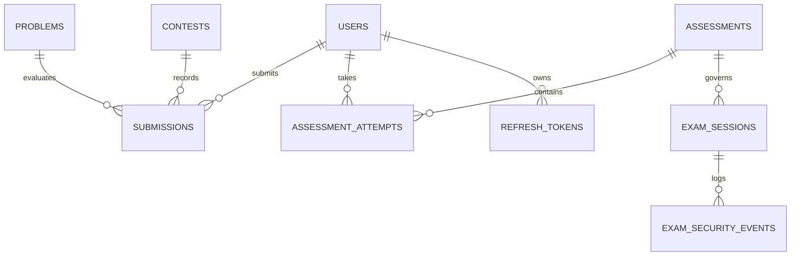
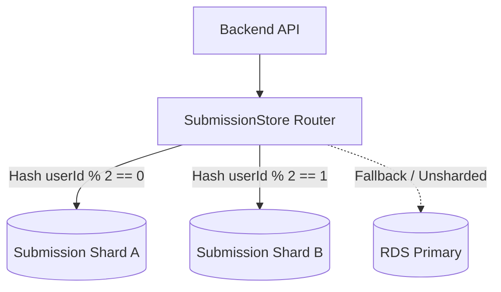

# Independent Pre-Production Engineering Audit: Database Architecture & Reliability

**Target Commit:** `3a3e9671d863e8abd95d19cbc7136c4227476ba8`  
**Discipline:** Database Architect and Performance Engineer  
**Target Engine:** AWS RDS PostgreSQL 14 (Multi-AZ, `db.t3.medium`)  
**Classification:** Deep Schema, Indexing, Partitioning and Sharding Assessment  

---

## 1. Schema & Relational Architecture Overview

The CodeSkill database is hosted on Amazon RDS for PostgreSQL version 14. Domain entities are defined using TypeORM in `backend-nestjs/src/database/entities/`, with custom migration scripts orchestrated through `run-practice-submission-source.ts`.



---

## 2. Table Partitioning Architecture (`declarative-partitioning.ts`)

To prevent performance degradation as submission logs and proctoring events scale into millions of rows, CodeSkill implements native PostgreSQL declarative range partitioning on three high-volume tables:
1. `submissions` (partitioned by `RANGE ("createdAt")`)
2. `exam_security_events` (partitioned by `RANGE ("createdAt")`)
3. `audit_logs` (partitioned by `RANGE ("timestamp")`)

### 2.1 Partition Key & Primary Key Constraints (`ISSUE-DB-002`)
In `backend-nestjs/src/database/migrations/declarative-partitioning.ts` (lines 139–166):
```sql
CREATE TABLE "submissions" (
  "id" uuid NOT NULL DEFAULT uuid_generate_v4(),
  "userId" uuid NOT NULL,
  "problemId" uuid NOT NULL,
  -- ...
  "createdAt" timestamp NOT NULL DEFAULT now(),
  CONSTRAINT "PK_submissions" PRIMARY KEY ("id", "createdAt")
) PARTITION BY RANGE ("createdAt");
```

#### Architectural Implications
1. **Loss of Global Unique Constraint on `id`:** In PostgreSQL, a unique constraint or primary key on a partitioned table must include all columns in the partition key. Because the primary key is `("id", "createdAt")`, PostgreSQL **cannot enforce global uniqueness on `id` alone**.
2. **Foreign Key Invalidation:** Other tables in PostgreSQL cannot create foreign key references pointing to `submissions.id` (`REFERENCES submissions(id)`), because foreign keys in PostgreSQL must target a unique column or unique constraint.
3. **Partition-Local Indices:** Line 168 creates:
   ```sql
   CREATE INDEX IF NOT EXISTS "IDX_submissions_id" ON "submissions" ("id");
   ```
   This creates an index on `id` within each partition table, allowing fast single-partition lookups, but queries querying `id` without `createdAt` must scan the index across **all active partitions** (partition pruning is disabled when the partition key is omitted from the `WHERE` clause).

### 2.2 Future Partition Maintenance & Catch-All Risks (`ISSUE-DB-003`)
In `generateDynamicPartitionsSql`:
- Monthly partitions are generated for the current base year (2026).
- Yearly partitions are generated for 2027 through 2030.
- A default catch-all partition is attached:
  ```sql
  CREATE TABLE IF NOT EXISTS "submissions_default" PARTITION OF "submissions" DEFAULT;
  ```

#### Operational Hazard with Default Partitions
In PostgreSQL, once rows spill into a `DEFAULT` partition, creating a new partition that covers those rows' timestamps is forbidden:
`ERROR: updated partition constraint for default partition would be violated by some row`
To attach a new monthly partition in 2027, the database administrator would be forced to take an exclusive lock (`ACCESS EXCLUSIVE`) on `submissions`, migrate existing rows out of `submissions_default`, and only then attach the partition. This causes severe production blocking.

**Recommendation:** Remove the `DEFAULT` partition in production; deploy an automated cron worker utilizing `pg_partman` or NestJS scheduler to create upcoming monthly partitions 30 days in advance.

---

## 3. Indexing Deficiencies & Query Optimization

### 3.1 B-Tree vs. GIN Indices on Array Targeting Columns (`ISSUE-DB-001`)
In `backend-nestjs/src/database/entities/assessment.entity.ts` (lines 15–20):
```typescript
@Index(['targetBatches'])
@Index(['targetDepartments'])
@Index(['targetStudentIds'])
@Index(['targetGroups'])
@Index(['targetSemesters'])
@Index(['targetSections'])
```
- In PostgreSQL, columns like `targetBatches` and `targetDepartments` are mapped to `text[]` (PostgreSQL text arrays).
- TypeORM's standard `@Index()` decorator generates a default **B-Tree index**.
- B-Tree indexes in PostgreSQL can only evaluate scalar comparisons (`=`, `<`, `>`) and whole-array equality (`array1 = array2`).
- They **cannot** be utilized for:
  - Array overlap: `targetBatches && ARRAY['2025']`
  - Array containment: `targetBatches @> ARRAY['2025']`
  - Element membership: `'2025' = ANY(targetBatches)`

**Result:** Any SQL query filtering assessments by student batch, department, or section results in a sequential table scan (`Seq Scan`). The existing B-Tree indexes provide zero query benefit while incurring disk and write-IOPS penalties.

**Remediation:** Drop B-tree indexes and create PostgreSQL GIN indexes:
```sql
CREATE INDEX idx_assessments_target_batches_gin ON assessments USING GIN ("targetBatches");
CREATE INDEX idx_assessments_target_departments_gin ON assessments USING GIN ("targetDepartments");
```

---

## 4. Submission Sharding Architecture (`SubmissionStore`)

To scale beyond a single primary database for high-throughput contest submissions, CodeSkill includes a horizontal application-level sharding module in `backend-nestjs/src/database/sharding/`.



### 4.1 Evaluation of `SubmissionStore`
- **Routing Strategy:** Sharding is partitioned deterministically using a hash of the `userId`:
  $$\text{Shard Bucket} = \text{MurmurHash3}(\text{userId}) \pmod N$$
- **Cross-Database Transactions:** Sharded writes do not participate in two-phase commits (2PC) with the primary database. The application correctly scopes domain data (users, problems, contests) to the primary database, while submission records reside on the designated shard.
- **Migration Safeguard:** The schema runner enforces `validateShardingState` to ensure that primary and shard database schemas remain synchronized.

---

## 5. PostgreSQL Sizing & Configuration Audit

### 5.1 Parameter Group Attachment Audit (`ISSUE-INFRA-003`)
In `terraform/modules/rds/variables.tf`:
```hcl
variable "create_parameter_group" {
  type    = bool
  default = false
}
```
And in `terraform/environments/production/main.tf`:
```hcl
module "rds" {
  source = "../../modules/rds"
  # create_parameter_group is omitted!
}
```
Because `create_parameter_group` defaults to `false` and was omitted from the production root module:
- `aws_db_parameter_group.postgres` in `modules/rds/main.tf` is **not created** (`count = 0`).
- The database is assigned AWS's default parameter group (`default.postgres14`).
- **Consequences:**
  1. `rds.force_ssl = 1` is **not enabled**; SSL connections are not strictly mandated by the database.
  2. `log_min_duration_statement = 1000` is **not enabled**; slow queries exceeding 1 second are not logged to CloudWatch.
  3. `max_connections` defaults to approximately 450 on `db.t3.medium`, allowing connection exhaustion to consume up to 3.5 GiB of RAM.

---

## 6. Database Remediation Plan

| Item | Action Required | Priority | Verification Method |
| :--- | :--- | :---: | :--- |
| **GIN Indexing** | Replace B-Tree indexes on `assessments` array columns with GIN indexes. | **HIGH** | `EXPLAIN ANALYZE SELECT * FROM assessments WHERE targetBatches @> ARRAY['2025'];` |
| **Parameter Group** | Set `create_parameter_group = true` in `terraform/environments/production/main.tf`. | **HIGH** | `SHOW rds.force_ssl;` returns `'on'` |
| **Partition Maintenance**| Implement automated cron job for creating upcoming monthly partitions without default lock contention. | **MEDIUM** | Query `pg_inherits` verifying future partition tables |
| **Atomic JSONB Updates** | Replace TypeORM `.save()` on `AssessmentAttempt` with atomic PostgreSQL `jsonb_insert` or append `||`. | **CRITICAL** | Concurrency load test simulating 50 concurrent saves and captures |
