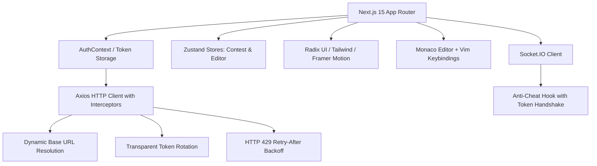

# Independent Pre-Production Engineering Audit: Frontend Architecture & Client Standards

**Target Commit:** `3a3e9671d863e8abd95d19cbc7136c4227476ba8`  
**Discipline:** Staff Frontend Engineer & Accessibility (a11y) Engineer  
**Framework:** Next.js 15.2.4 (App Router), React 19.0.0, TypeScript 5.9.3  
**Classification:** Empirical Verification & Source Code Audit  

---

## 1. Automated Verification Results

Empirical verification commands were executed against the frontend codebase (`frontend-v2/`) at commit `3a3e9671`:

| Verification Gate | Command Executed | Outcome | Empirical Metrics |
| :--- | :--- | :---: | :--- |
| **Frontend Unit Test Suite** | `npm test --prefix frontend-v2 -- --runInBand` | **PASS** | **47 / 47 test suites passed** (344 / 344 tests passed, 0 failures, 11.66s runtime) |
| **TypeScript Static Analysis** | `tsc --noEmit --incremental false` | **PASS** | **0 compilation errors** |
| **ESLint Static Analysis** | `npm run lint --prefix frontend-v2` | **PASS (0 Errors)** | **0 errors**, 403 non-blocking warnings (React Hook advice & unused vars) |

---

## 2. Frontend Architectural Evaluation



### 2.1 Dynamic Base URL Resolution (`api-base-url.ts`)
To prevent hardcoded build-time URLs from breaking deployments across multiple environments, the client implements dynamic base URL detection in `frontend-v2/src/lib/api-base-url.ts`:
- On the server (SSR), it routes requests via `INTERNAL_BACKEND_URL` or fallback `http://127.0.0.1:5001/api`.
- In the browser, `getBrowserApiBaseURL()` detects the current window host, protocol, and port, resolving relative `/api` paths through the Application Load Balancer or reverse proxy.

### 2.2 Transparent Token Rotation & 429 Rate-Limit Resilience (`api.ts`)
In `frontend-v2/src/config/api.ts`:
1. **Automated Refresh on 401:** When an access token expires during an active session, the response interceptor catches the HTTP 401, queues pending requests in `refreshSubscribers`, exchanges the refresh token via `/auth/refresh`, updates `localStorage`, and retries all queued requests seamlessly.
2. **RFC 6585 Exponential Backoff on 429:** When requests encounter rate limits (`HTTP 429 Too Many Requests`), the interceptor inspects the `Retry-After` header and backs off exponentially before retrying up to 3 times for autosaves and proctoring captures.

---

## 3. Detailed Frontend Issues & Defect Analysis

### 3.1 Hardcoded `http://localhost:5000` in AI Question Wizard (`ISSUE-FE-001`)
- **File:** `frontend-v2/src/app/admin/questions/create/_components/AIAssistance.tsx` (Lines 35, 50)
- **Defect:**
  ```typescript
  const res = await fetch("http://localhost:5000/api/ai/generate-question-helper", { ... });
  const socket = io("http://localhost:5000/ai-generation", { transports: ['websocket'] });
  ```
- **Consequence:** In production on `https://codeskill.org`, browsers block this fetch due to Mixed Content security rules (HTTPS cannot request insecure HTTP). Furthermore, the port is incorrect (backend runs on port 5001), and `localhost` resolves to the user's personal machine.
- **Remediation:** Replace with the configured `api` axios client and use `process.env.NEXT_PUBLIC_WS_URL || window.location.origin` for the WebSocket connection.

### 3.2 Synchronous Nested State Dispatch in Loader Effect (`ISSUE-FE-002`)
- **File:** `frontend-v2/src/components/ui/modern-loader.tsx` (Lines 87–97)
- **Defect:**
  ```typescript
  useEffect(() => {
    const timer = setTimeout(() => {
      setCurrentLine((prev) => {
        const nextLine = prev + 1;
        if (nextLine >= lines.length - 10)
          setLines((old) => [...old, ...generateDeterministicLines(30, old.length)]);
        return nextLine;
      });
    }, 200);
    return () => clearTimeout(timer);
  }, [currentLine, lines.length]);
  ```
- **Consequence:** Invoking `setLines()` inside the state updater callback of `setCurrentLine()` violates React rendering guidelines. In React 19 concurrent mode, nested state dispatch triggers cascading renders and potential UI tearing.
- **Remediation:** Split into two independent effects: one advancing `currentLine`, and a separate effect appending new lines when `currentLine` nears the buffer boundary.

### 3.3 Unbounded Memory Growth in Code Generation Animation (`ISSUE-FE-003`)
- **File:** `frontend-v2/src/components/ui/modern-loader.tsx` (Lines 69, 92)
- **Defect:** While `MAX_LINES = 100` is defined, line 92 continuously appends 30 lines without slicing or removing off-screen lines. If a compilation or evaluation screen remains active for several minutes, thousands of DOM elements are retained in memory.
- **Remediation:** Enforce the cap: `setLines((old) => [...old, ...newLines].slice(-MAX_LINES))`.

### 3.4 Accessibility Gaps on OTP Digit Input Cells (`ISSUE-FE-005`)
- **File:** `frontend-v2/src/components/ui/otp-input.tsx` (Lines 170–185)
- **Defect:** Individual digit input boxes lack explicit `aria-label` or `aria-describedby` associations. Screen readers announce each cell as an unlabelled text edit field, failing WCAG 2.1 AA Success Criterion 1.3.1 (Info and Relationships).
- **Remediation:** Add `aria-label={`Digit ${index + 1} of ${length}`}` and `aria-required="true"`.

---

## 4. Frontend Remediation Priority Matrix

| Issue ID | Component | Severity | Remediation Effort |
| :--- | :--- | :---: | :---: |
| **ISSUE-FE-001** | `AIAssistance.tsx` (Remove localhost) | **HIGH** | 1 Hour |
| **ISSUE-FE-002** | `modern-loader.tsx` (Decouple nested setters) | **MEDIUM** | 1 Hour |
| **ISSUE-FE-003** | `modern-loader.tsx` (Enforce MAX_LINES cap) | **MEDIUM** | 30 Mins |
| **ISSUE-FE-004** | `DSAAssessmentEditor.tsx` (Add debounce) | **MEDIUM** | 1 Hour |
| **ISSUE-FE-005** | `otp-input.tsx` (Add aria labels) | **LOW** | 30 Mins |
| **ISSUE-FE-006** | `sign-in-page.tsx` (Use Next.js Image) | **LOW** | 30 Mins |
