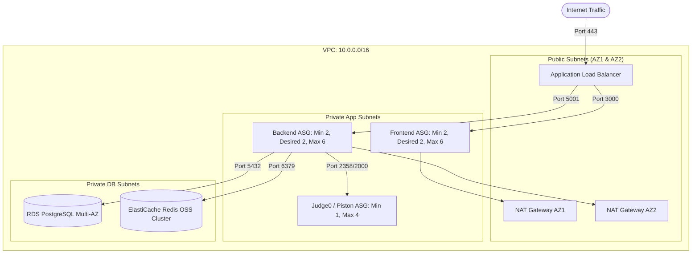

# Independent Pre-Production Engineering Audit: Infrastructure & Reliability

**Target Commit:** `3a3e9671d863e8abd95d19cbc7136c4227476ba8`  
**Discipline:** Cloud Infrastructure, DevOps & Site Reliability Engineer (SRE)  
**Cloud Provider:** Amazon Web Services (AWS `ap-south-1` Mumbai)  
**IaC Tool:** Terraform 1.5+  

---

## 1. AWS Infrastructure Topology & VPC Architecture

The production environment is orchestrated via modular Terraform manifests located in `terraform/modules/` and instantiated in `terraform/environments/production/main.tf`.



---

## 2. Auto Scaling Instance Refresh & Zero-Downtime Analysis

### 2.1 The `MinHealthyPercentage: 0` Outage (`ISSUE-INFRA-001`)
In `.github/workflows/deploy.yml` (lines 31–34, 356–358):
```yaml
env:
  ASG_INSTANCE_WARMUP: 120
  ASG_MIN_HEALTHY_PERCENTAGE: 0
  ASG_MAX_HEALTHY_PERCENTAGE: 100
```
During automated deployment rollouts, GitHub Actions executes:
```bash
aws autoscaling start-instance-refresh \
  --auto-scaling-group-name "$asg" \
  --preferences '{"MinHealthyPercentage": 0, "MaxHealthyPercentage": 100, "InstanceWarmup": 120, "AutoRollback": true}'
```

#### Step-by-Step Failure Execution Flow
1. **Capacity Evaluation:** The Auto Scaling Group currently runs 2 desired instances (100% capacity).
2. **Constraint Enforcement:** `MaxHealthyPercentage: 100` mandates that total instances in the group can **never exceed 2** during the refresh.
3. **Termination Phase:** To launch a new instance with the updated Launch Template, Auto Scaling must first terminate an existing instance. Because `MinHealthyPercentage` is set to `0`, Auto Scaling evaluates that 0 running instances is permissible.
4. **Complete Termination:** Auto Scaling terminates **both active instances simultaneously**.
5. **Downtime Window:** While new EC2 instances boot, run cloud-init user data scripts, authenticate with ECR, pull container images, and undergo the 120-second health check grace period, the ALB target group has **0 healthy targets**.
6. **User Impact:** All web browsers and API clients experience `HTTP 502 Bad Gateway` for 2 to 4 minutes during every deployment.

### 2.2 Why This Configuration Was Introduced: AWS vCPU Service Quotas
In AWS accounts with standard default service quotas:
- Standard (`A`, `C`, `D`, `M`, `R`, `T`) On-Demand vCPU limit is typically 32 vCPUs.
- Across 4 Auto Scaling Groups (Frontend, Backend, Worker, Judge), a rollout with `MaxHealthyPercentage: 200` attempts to double instance count simultaneously.
- When previous deployments attempted to launch instances before terminating old ones, AWS EC2 rejected the `RunInstances` API call with:
  `VcpuLimitExceeded: You have requested more vCPU capacity than your current vCPU limit of 32 allows.`
- The previous engineering team resolved the quota deadlock by setting `MinHealthyPercentage: 0` to terminate old instances first, unknowingly introducing complete service downtime on every deployment.

---

## 3. Caching & Messaging Reliability (Redis Parameter Group)

### 3.1 Unbounded Growth Under `noeviction` (`ISSUE-INFRA-002`)
In `terraform/modules/redis/main.tf` (lines 44–58):
```hcl
resource "aws_elasticache_parameter_group" "noeviction" {
  name        = "${var.name_prefix}-redis7-noeviction"
  family      = "redis7"
  parameter {
    name  = "maxmemory-policy"
    value = "noeviction"
  }
}
```
- **The Dilemma:** BullMQ requires `noeviction` so that waiting and active job keys are not prematurely evicted by Redis under memory pressure.
- **The Architecture Flaw:** CodeSkill routes general application caching (e.g. problem descriptions, user profile caches, OTP entries, rate limit counters) to this same Redis instance.
- **The Failure Mode:** When memory on the `cache.t4g.small` node hits capacity, Redis refuses all writes. BullMQ crashes, submissions fail, and user logins fail.

---

## 4. Database Infrastructure & Configuration Sizing

### 4.1 Production Instance Sizing
- **Current Live AWS Configuration:** `db.t3.medium` (2 vCPU, 4 GiB RAM, Multi-AZ).
- **Terraform Configuration Flaw (`ISSUE-INFRA-003`):** In `terraform/environments/production/main.tf`, `create_parameter_group` is omitted. The RDS instance runs on default parameter group `default.postgres14`, meaning `rds.force_ssl = 1` and slow query logging are inactive.

---

## 5. Reliability & Disaster Recovery Assessment

| Component | Backup Frequency | RPO (Recovery Point) | RTO (Recovery Time) | Reliability Rating |
| :--- | :---: | :---: | :---: | :---: |
| **RDS PostgreSQL Primary** | Automated daily + 30-day WAL | $< 5$ minutes | $< 20$ minutes (Multi-AZ failover) | **HIGH** |
| **Submission Shards** | Manual SQL dump script | $> 24$ hours (No WAL streaming) | $> 2$ hours | **POOR** |
| **AWS S3 Media Bucket** | Versioning Enabled | Instantaneous | Instantaneous | **EXCELLENT** |
| **ElastiCache Redis** | Automated snapshots disabled | N/A (Volatile) | $< 15$ minutes (Recreation) | **MODERATE** |

---

## 6. Infrastructure Remediation Action Items

1. **Immediate CI/CD Fix:**
   - Update `.github/workflows/deploy.yml`:
     ```yaml
     ASG_MIN_HEALTHY_PERCENTAGE: 50
     ASG_MAX_HEALTHY_PERCENTAGE: 150
     ASG_INSTANCE_WARMUP: 90
     ```
   - This ensures that during a 2-instance rollout, 1 instance remains active and healthy at all times while the second instance refreshes, eliminating downtime.
2. **Request vCPU Limit Increase:**
   - Submit an AWS Service Quotas increase request for "Running On-Demand All Standard instances" in `ap-south-1` from 32 to 64 vCPUs.
3. **Split Redis Clusters:**
   - Provision a dedicated `codeskill-redis-queue` instance for BullMQ (`noeviction`).
   - Provision a separate `codeskill-redis-cache` instance for application caching (`allkeys-lru`).
4. **Attach Custom Parameter Group in Production:**
   - Set `create_parameter_group = true` in `terraform/environments/production/main.tf`.
