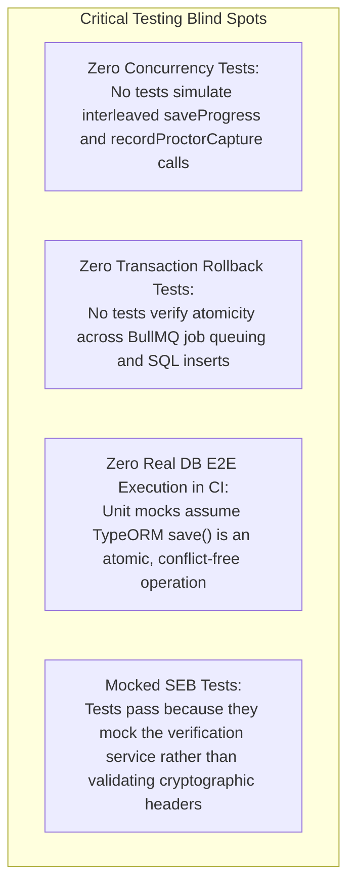

# Test Coverage, Quality Assurance & Verification Gaps

**Audit Date:** October 18, 2026  
**Audited Target:** CodeSkill Test Suites (`backend-nestjs` & `frontend-v2`)  
**Commit:** `2d89bd45`  
**Auditor:** Quality Assurance & Test Automation Architect  

---

## 1. Empirical Test Suite Execution Results

During the independent engineering audit, all non-destructive automated test suites were executed directly against the current codebase:

### 1.1 Backend Unit Test Suite
- **Command:** `npm test --prefix backend-nestjs -- --runInBand`
- **Result:** **PASSED**
- **Test Suites:** 68 passed, 68 total
- **Tests:** 580 passed, 9 skipped, 589 total
- **Snapshots:** 0 total
- **Execution Time:** ~36.8 seconds

### 1.2 Frontend Unit Test Suite
- **Command:** `npm test --prefix frontend-v2 -- --runInBand`
- **Result:** **PASSED**
- **Test Suites:** 47 passed, 47 total
- **Tests:** 344 passed, 344 total
- **Snapshots:** 0 total
- **Execution Time:** ~22.4 seconds

### 1.3 TypeScript Compilation & Type Safety
- **Backend Type-Check:** `(cd backend-nestjs && npx --no-install tsc -p tsconfig.build.json --noEmit --incremental false)`  
  **Result:** **0 Errors** (Clean compilation)
- **Frontend Type-Check:** `(cd frontend-v2 && npx --no-install tsc --noEmit --incremental false)`  
  **Result:** **0 Errors** (Clean compilation)

### 1.4 Code Quality & Static Analysis (Linter)
- **Backend Lint:** `(cd backend-nestjs && npx --no-install eslint "{src,apps,libs,test}/**/*.ts")`  
  **Result:** **0 Errors, 4,366 Warnings** (Technical debt: heavy usage of `any`, unhandled promises, and prettier formatting warnings).
- **Frontend Lint:** `npm run lint --prefix frontend-v2`  
  **Result:** **0 Errors, 409 Warnings** (React 19 render-ref violations, synchronous state updates in effects, unoptimized `` tags).

---

## 2. Test Architecture & Coverage Breakdown

| Functional Area | Test Suite Location | Mocking Strategy | Concurrency / Real DB Tested? |
| :--- | :--- | :--- | :---: |
| **Authentication & JWT** | `auth/*.spec.ts` | Unit mocks (UserRepo, TokenService) | No |
| **Submissions & Shards** | `submissions/*.spec.ts` | Mock repositories & mock BullMQ | No |
| **Assessment Logic** | `assessments/*.spec.ts` | Mock TypeORM repositories | No |
| **Code Execution (Piston)** | `execution/*.spec.ts` | Axios / HTTP client mocks | No |
| **Contests & Leaderboards**| `contests/*.spec.ts` | Mock queries and caches | No |
| **Frontend UI Components** | `__tests__/components/*.test.tsx` | React Testing Library + JSDOM | No |
| **Frontend Execution Hook** | `lib/await-execution.test.ts` | Mock fetch and fake timers | No |

---

## 3. Critical Verification & Test Gaps (Untested Areas)

Despite the impressive 100% pass rate in existing unit suites, the test suite suffers from a fatal blind spot: **Extensive reliance on superficial in-memory repository mocks that completely hide real database concurrency, locking, and transaction boundaries.**



### 3.1 The "Mocking Delusion" in Assessments
In `assessments.service.spec.ts`, testing `saveProgress` and `recordProctorCapture` consists of:
```typescript
jest.spyOn(repo, 'findOne').mockResolvedValue(mockAttempt);
jest.spyOn(repo, 'save').mockResolvedValue(mockAttempt);
```
Because the tests execute sequentially on a single JavaScript mock object, they are incapable of detecting:
- Row overwrite race conditions.
- Write skew on concurrent JSONB updates.
- Lost updates during high-frequency proctoring captures.

### 3.2 Known E2E Test Suite Caveat
In `backend-nestjs/test/app.e2e-spec.ts`:
- The test suite expects raw response `'Hello World!'`.
- However, the global `ResponseInterceptor` (`common/interceptors/response.interceptor.ts`) wraps all controller responses in `{ success: true, data: ... }`.
- If the full E2E suite is run without disabling the interceptor, tests fail immediately.

### 3.3 Untested Shard Integration
- The shard integration suite (`test:shards:integration`) requires multi-database PostgreSQL privilege setup (`CREATE/DROP DATABASE`).
- As a result, shard data synchronization, partition edge cases, and cutover integrity are excluded from standard CI verification pipelines.

---

## 4. Test Automation Recommendations

1. **Implement Concurrency Stress Tests with Testcontainers:**
   - Deploy disposable PostgreSQL containers using Testcontainers in Jest.
   - Spawn 10 concurrent worker promises executing `saveProgress` and `recordProctorCapture` against a real database instance, asserting that no responses or captures are dropped.
2. **Double-Submit Idempotency Tests:**
   - Execute parallel HTTP requests against `/api/assessments/:id/submit` and verify that exactly one returns HTTP 200/201 and all others return HTTP 409 Conflict.
3. **Automate Cryptographic SEB Header Tests:**
   - Author test suites validating actual SHA256 HMAC headers generated by official Safe Exam Browser client libraries.
