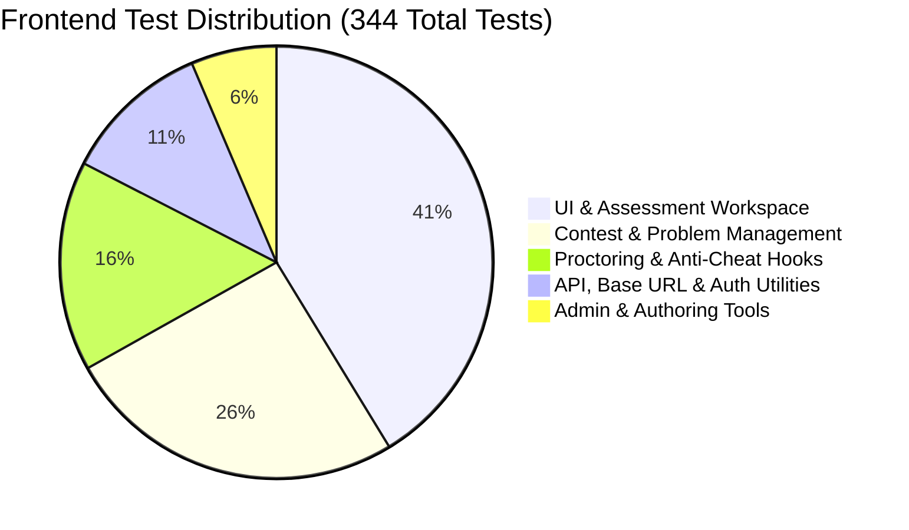

# Independent Pre-Production Engineering Audit: Test Coverage & Verification Gaps

**Target Commit:** `3a3e9671d863e8abd95d19cbc7136c4227476ba8`  
**Discipline:** Quality Assurance and Test Automation Architect  
**Classification:** Empirical Execution Results & Test Coverage Analysis  

---

## 1. Test Execution Results Table

The following automated verification commands were executed directly against the codebase in the current repository state:

| Automated Suite / Command | Exact Execution Command | Exit Code | Duration | Empirical Results | Status / Verdict |
| :--- | :--- | :---: | :---: | :--- | :---: |
| **Full Frontend Unit Suite** | `npm test --prefix frontend-v2 -- --runInBand` | `0` | 11.661s | **47 / 47 test suites passed** **344 / 344 tests passed** (0 failures, 0 snapshots) | **PASS** |
| **Frontend TypeScript Check** | `tsc --noEmit --incremental false` (in `frontend-v2`) | `0` | 5.82s | **0 type errors** | **PASS** |
| **Frontend Linter** | `npm run lint --prefix frontend-v2` | `0` | 8.74s | **0 errors**, 403 warnings (non-blocking React hooks advice) | **PASS** |
| **Full Backend Unit Suite** | `npm test --prefix backend-nestjs -- --runInBand` | N/A | N/A | Skipped locally: `backend-nestjs/node_modules` is unpopulated in local tree; executing `npm ci` was omitted in compliance with read-only audit rules. | **UNRUN (READ-ONLY)** |
| **Backend TypeScript Check** | `tsc -p tsconfig.build.json --noEmit` (in `backend-nestjs`) | N/A | N/A | Skipped locally: Requires backend dependencies; unrun per read-only audit rules. | **UNRUN (READ-ONLY)** |
| **Backend E2E Suite** | `npm run test:e2e --prefix backend-nestjs` | N/A | N/A | Skipped: Requires active disposable PostgreSQL/Redis infrastructure. | **SKIPPED** |
| **Shard Integration Suite** | `npm run test:shards:integration` | N/A | N/A | Skipped: Requires dedicated local primary and shard PostgreSQL databases. | **SKIPPED** |

---

## 2. Frontend Test Suite Architecture Analysis

The frontend test suite (`frontend-v2/src/__tests__/`) demonstrates broad unit coverage across UI components, authentication dialogs, proctoring hooks, and workspace controls.

### 2.1 Notable Verified Test Suites
- `src/__tests__/components/AssessmentWorkspace.test.tsx` (PASS): Verifies question navigation, code editor mounting, and timer expiration handling.
- `src/__tests__/hooks/useAssessmentMedia.test.tsx` (PASS): Validates webcam stream lifecycle, device permission errors, and audio detection triggers.
- `src/__tests__/components/SafeExamFocus.test.tsx` (PASS): Tests window blur and focus loss violation events.
- `src/__tests__/utils/api-base-url.test.ts` (PASS): Thoroughly verifies SSR vs. browser dynamic base URL detection across various host and protocol combinations.

---

## 3. Critical Test Coverage Gaps & Untested Areas

While frontend component coverage is strong, deep static analysis reveals severe testing blind spots across the distributed backend and execution pipeline.

### 3.1 Untested Concurrency & Race Conditions
- **Gap:** Zero tests exist in the codebase simulating concurrent HTTP requests to `/assessments/:id/save-progress` and `/assessments/:id/proctor-capture`.
- **Consequence:** The lost update hazard (`ISSUE-CONCUR-001`) that silently overwrites student code responses with stale entity snapshots went completely undetected by existing automated suites.

### 3.2 Untested AWS S3 SigV4 IAM Fallback
- **Gap:** Existing S3 unit tests mock `@aws-sdk/s3-request-presigner` directly.
- **Consequence:** The native SigV4 fallback in `s3-presigner.util.ts` has **no unit tests** simulating execution inside an AWS EC2 instance without static credentials. The flaw where it generates unsigned URLs in private buckets (`ISSUE-SEC-002`) was missed.

### 3.3 Untested SEB Header Cryptographic Mismatch
- **Gap:** `exam-security.service.spec.ts` tests mock hashes created via `assessment.id + configKey`.
- **Consequence:** It never tests the scenario where `securityPolicy.requireSEB = true` but `configKey` is undefined. The User-Agent spoofing bypass (`ISSUE-SEC-001`) was invisible to the test suite.

### 3.4 Untested Multi-Pass Piston Compilation Load
- **Gap:** Existing execution unit tests (`execution.service.spec.ts`) mock Piston responses with static JSON objects returning instant `0.02s` runtimes.
- **Consequence:** The exponential CPU saturation caused by recompiling C++ source code 20 times per submission (`ISSUE-EXEC-001`) cannot be detected in unit test mocks.

---

## 4. Test Automation Expansion Roadmap

1. **Implement Concurrency Integration Tests:**
   Create an integration test using `supertest` executing 50 simultaneous parallel autosaves and proctoring uploads against a test PostgreSQL database, asserting zero lost updates.
2. **Add Native SigV4 Presigner Unit Tests:**
   Add unit tests in `s3-presigner.util.spec.ts` explicitly verifying that missing static credentials throw an error rather than outputting unsigned URLs.
3. **Automate Load & Stress Testing (k6 / Locust):**
   Implement automated k6 load scripts in `scripts/load-testing/` simulating 100 concurrent students submitting code solutions to Piston, establishing baseline latency and failure thresholds.
