# Remediation Roadmap & Priority Engineering Plan

**Audit Date:** October 18, 2026  
**Audited Target:** CodeSkill Platform  
**Commit:** `2d89bd45`  
**Auditor:** Principal Software Architect & Engineering Director  

---

## 1. Remediation Phase Overview & Dependency Hierarchy

To ensure system stability and eliminate production-blocking risks without introducing regressions, remediation must follow a strictly ordered four-phase sequence:

```mermaid
flowchart TD
    subgraph Phase1["Phase 1: Release Blockers (Data Loss & Security)"]
        F1["F1: Decompose assessment_attempts (ISSUE-CONC-001)"]
        F2["F2: Atomic submission lock & CAS (ISSUE-CONC-002)"]
        F3["F3: Cryptographic SEB verification (ISSUE-SEC-001)"]
        F4["F4: Remove client violation overwrite (ISSUE-SEC-002)"]
    end

    subgraph Phase2["Phase 2: Infrastructure & SRE Hardening"]
        F5["F5: S3 Presigned URLs for proctoring (ISSUE-INFRA-001)"]
        F6["F6: Fix telemetry route prefix mismatch (ISSUE-OBS-001)"]
        F7["F7: Consolidate health controllers (ISSUE-ROUT-001)"]
        F8["F8: Secure Prometheus metrics IP check (ISSUE-SEC-003)"]
        F9["F9: Eliminate plaintext passwords (ISSUE-SEC-004)"]
        F10["F10: Right-size RDS pool & max_connections (ISSUE-INFRA-002)"]
    end

    subgraph Phase3["Phase 3: Performance & Scalability"]
        F11["F11: Piston batch compilation pipeline (ISSUE-PERF-001)"]
        F12["F12: Redis cluster split & volatile-lru (ISSUE-INFRA-003)"]
        F13["F13: Atomic discussion counters (ISSUE-DATA-001)"]
        F14["F14: Redis-backed Pet rate limiter (ISSUE-PERF-002)"]
        F15["F15: Automate dynamic partitioning (ISSUE-DB-002)"]
    end

    subgraph Phase4["Phase 4: Client & Quality Polish"]
        F16["F16: TypeORM null: 'throw' safety (ISSUE-DB-001)"]
        F17["F17: Fix React 19 render-ref warnings (ISSUE-FE-001)"]
        F18["F18: Remove unreliable DevTools timing heuristics (ISSUE-SEC-005)"]
    end

    Phase1 --> Phase2 --> Phase3 --> Phase4
```

---

## 2. Phase 1: Critical Release Blockers (Immediate Action Required)

### Task 1.1: Decompose `AssessmentAttempt` & Prevent Data Loss (ISSUE-CONC-001)
- **Target:** `backend-nestjs/src/assessments/assessments.service.ts` & database entities.
- **Complexity:** Medium (3–4 engineering days).
- **Dependencies:** None.
- **Steps:**
  1. Author a database migration creating `assessment_proctor_captures` and `assessment_proctor_violations` tables referencing `attempt_id`.
  2. Migrate existing JSONB arrays into the new tables.
  3. Refactor `recordProctorCapture` and `recordViolation` to execute pure `INSERT` queries on child tables.
  4. For `saveProgress`, update only `responses` using a targeted SQL statement:
     `UPDATE assessment_attempts SET responses = $1, updated_at = NOW() WHERE id = $2`.
- **Verification:** Run a concurrent benchmark firing 50 parallel saves and 50 captures; assert 0 lost responses.

### Task 1.2: Atomic Lock on Assessment Submission (ISSUE-CONC-002)
- **Target:** `backend-nestjs/src/assessments/assessments.service.ts` (L1624–1750).
- **Complexity:** Low (1 engineering day).
- **Dependencies:** None.
- **Steps:**
  1. Refactor `submitAttempt` to perform an atomic compare-and-swap state transition:
     `UPDATE assessment_attempts SET status = 'submitting' WHERE id = $1 AND status = 'in_progress' RETURNING id`.
  2. If 0 rows return, immediately throw `ConflictException('Assessment is already being submitted or completed')`.
  3. Execute `evaluateAttempt` within a protected background job or isolated transaction.
- **Verification:** Unit test firing 5 simultaneous POST requests to `/api/assessments/:id/submit`; assert exactly 1 succeeds.

### Task 1.3: Cryptographic Safe Exam Browser Verification (ISSUE-SEC-001)
- **Target:** `backend-nestjs/src/exam-security/exam-security.service.ts`.
- **Complexity:** Low-Medium (2 engineering days).
- **Dependencies:** None.
- **Steps:**
  1. Read headers `X-SafeExamBrowser-RequestHash` and `X-SafeExamBrowser-ConfigKeyHash`.
  2. Compute SHA-256 HMAC of the requested URL + server-stored SEB Config Key.
  3. Compare hashes using constant-time comparison (`crypto.timingSafeEqual`).
  4. Remove hardcoded `'simulate-secure-token'` and issue cryptographically signed session tokens.
- **Verification:** Automated tests asserting requests without genuine headers return HTTP 403.

### Task 1.4: Immutable Server-Side Proctoring Violations (ISSUE-SEC-002)
- **Target:** `backend-nestjs/src/assessments/assessments.service.ts` (L1917–1926).
- **Complexity:** Low (0.5 engineering days).
- **Dependencies:** None.
- **Steps:**
  1. Delete logic comparing client violation array length with server violation array length.
  2. Treat client violation submissions as unverified claims; never overwrite server violation records.
- **Verification:** Test submitting a truncated or synthetic violation array; assert server records remain unchanged.

---

## 3. Phase 2: Infrastructure Stability & Observability

### Task 2.1: S3 Presigned URLs for Proctoring Media (ISSUE-INFRA-001)
- **Target:** `backend-nestjs/src/s3/s3.service.ts` (L90–98).
- **Steps:** Inject `@aws-sdk/s3-request-presigner` and implement `getPresignedUrl(key: string, expiresInSeconds = 3600)` for all non-avatar asset retrieval.

### Task 2.2: Correct Client Telemetry Path (ISSUE-OBS-001)
- **Target:** `backend-nestjs/src/observability/health/health.controller.ts` (L106).
- **Steps:** Change `@Post('api/telemetry/client-events')` to `@Post('telemetry/client-events')`.

### Task 2.3: Consolidate Conflicting Health Controllers (ISSUE-ROUT-001)
- **Target:** Delete `src/health/health.controller.ts` and route all health probing to a standardized `@nestjs/terminus` controller.

### Task 2.4: Secure Metrics IP Filter & Enforce Scrape Token (ISSUE-SEC-003)
- **Target:** `backend-nestjs/src/observability/metrics/metrics.controller.ts` (L20–29).
- **Steps:** Use `ipaddr.js` for RFC 1918 CIDR matching and require a mandatory `Bearer` token on `/api/metrics`.

### Task 2.5: Remove Plaintext Passwords in `email_jobs` (ISSUE-SEC-004)
- **Target:** `backend-nestjs/src/students/students.service.ts` (L782).
- **Steps:** Store a cryptographically random, hashed activation token and send an activation link instead of raw passwords.

### Task 2.6: Right-Size RDS Connections & Deploy PgBouncer (ISSUE-INFRA-002)
- **Target:** `terraform/modules/rds/main.tf` & `database.module.ts`.
- **Steps:** Deploy AWS RDS Proxy or increase `max_connections` parameter group ceiling to 200+. Set backend `DB_POOL_MAX = 10`.

---

## 4. Phase 3: Performance, Scalability & Architecture

### Task 3.1: Piston Batch Compilation Pipeline (ISSUE-PERF-001)
- **Target:** `backend-nestjs/src/execution/execution.service.ts` (L460–482).
- **Steps:** For compiled languages (C, C++, Java, Rust), invoke Piston to compile source into a binary once. Execute all $T$ test cases against the binary artifact, reducing execution CPU by up to 80%.

### Task 3.2: Separate Redis Clusters & Eviction Policy (ISSUE-INFRA-003)
- **Target:** `terraform/modules/redis/main.tf` & `backend-nestjs/src/app.module.ts`.
- **Steps:** Provision two Redis instances: (1) `bullmq-redis` with `noeviction` for queues, (2) `cache-redis` with `volatile-lru` for rate-limiting, session, and cache.

### Task 3.3: Atomic Discussion Vote Counters (ISSUE-DATA-001)
- **Target:** `backend-nestjs/src/discussions/discussions.service.ts`.
- **Steps:** Replace `thread.upvotes = thread.upvotes + 1; save()` with `this.threadRepo.increment({ id }, 'upvotes', 1)`.

### Task 3.4: Dynamic Partition Maintenance (ISSUE-DB-002)
- **Target:** `backend-nestjs/src/database/declarative-partitioning.ts`.
- **Steps:** Implement automated partition generation using `pg_partman` or a scheduled monthly cron job.

---

## 5. Phase 4: Client & Quality Polish

### Task 4.1: Enforce TypeORM Safe Mode (ISSUE-DB-001)
- **Target:** `backend-nestjs/src/database/database.module.ts`.
- **Steps:** Change `invalidWhereValuesBehavior: { null: 'throw' }`.

### Task 4.2: Resolve React 19 Render-Phase Warnings (ISSUE-FE-001)
- **Target:** `frontend-v2/src/components/auth/otp-input.tsx` & `useFullscreen.ts`.
- **Steps:** Defer ref interactions and focus mutations into `useEffect` hooks.

### Task 4.3: Refactor Anti-Cheat DevTools Heuristics (ISSUE-SEC-005)
- **Target:** `frontend-v2/src/hooks/useDevToolsDetect.ts`.
- **Steps:** Remove console timing benchmarks; rely exclusively on window dimension deltas and official SEB integration.
