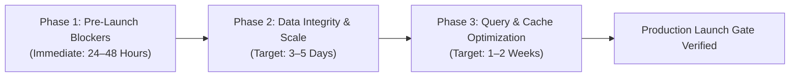

# Independent Pre-Production Engineering Audit: Remediation Priority & Action Plan

**Target Commit:** `3a3e9671d863e8abd95d19cbc7136c4227476ba8`  
**Discipline:** Principal Software Architect & Site Reliability Engineer (SRE)  
**Classification:** Actionable Remediation Specifications & Phased Implementation Plan  

---

## 1. Remediation Phasing Overview

All 28 identified issues are organized into three sequential remediation phases based on risk to production availability, security integrity, and data loss.



---

## 2. Phase 1: Pre-Launch Blockers (Immediate: 24–48 Hours)

These items represent immediate risks of total system outage, complete exam security bypass, or broken production features.

### 2.1 [FIX-01] Eliminate Deployment Outage in Auto Scaling Instance Refresh
- **Addresses:** `ISSUE-INFRA-001`
- **Affected File:** `.github/workflows/deploy.yml` (Lines 32–33)
- **Concrete Code Change:**
  ```yaml
  # Replace:
  ASG_MIN_HEALTHY_PERCENTAGE: 0
  ASG_MAX_HEALTHY_PERCENTAGE: 100

  # With:
  ASG_MIN_HEALTHY_PERCENTAGE: 50
  ASG_MAX_HEALTHY_PERCENTAGE: 150
  ```
- **Rationale:** Setting `MinHealthyPercentage: 50` ensures that in a 2-instance ASG, at least 1 healthy instance continues serving production traffic while the other refreshes, completely eliminating the 2–4 minute HTTP 502 outage window.
- **Effort:** 15 minutes.
- **Verification:** Execute a test deployment in a staging branch; assert that an automated `curl` probe against `/health` returns `200 OK` continuously during the entire instance refresh.
- **Regression Risk:** Low. Requires verifying that AWS account vCPU quota has at least 2 spare vCPUs.

---

### 2.2 [FIX-02] Harden Safe Exam Browser (SEB) Authentication
- **Addresses:** `ISSUE-SEC-001`
- **Affected File:** `backend-nestjs/src/exam-security/exam-security.service.ts` (Lines 42–63)
- **Concrete Code Change:**
  ```typescript
  // Reject User-Agent spoofing when genuine headers are missing
  if (security?.requireSEB) {
    if (!sebReqHash) {
      throw new ForbiddenException(
        'Safe Exam Browser verification failed. Missing genuine SEB request headers.',
      );
    }
    if (!security.configKey) {
      throw new ForbiddenException(
        'This assessment requires Safe Exam Browser, but no configuration key is set by administrator.',
      );
    }
    // ... proceed with cryptographic hash verification
  }
  ```
- **Effort:** 1 hour.
- **Verification:** Execute curl requests with `User-Agent: SafeExamBrowser`; assert that requests without valid `X-SafeExamBrowser-RequestHash` receive `403 Forbidden`.
- **Regression Risk:** Low.

---

### 2.3 [FIX-03] Fix Hardcoded `localhost:5000` in Question AI Wizard
- **Addresses:** `ISSUE-FE-001`
- **Affected File:** `frontend-v2/src/app/admin/questions/create/_components/AIAssistance.tsx` (Lines 35, 50)
- **Concrete Code Change:**
  ```typescript
  // Replace line 35:
  const res = await api.post("/ai/generate-question-helper", { prompt, type: actionId });
  const data = res.data;

  // Replace line 50:
  const wsUrl = process.env.NEXT_PUBLIC_WS_URL || (typeof window !== "undefined" ? window.location.origin : "");
  const socket = io(`${wsUrl}/ai-generation`, { path: "/socket.io", transports: ['websocket'] });
  ```
- **Effort:** 1 hour.
- **Verification:** Open the question creation wizard on a non-localhost URL; verify that clicking "Generate with AI" opens the socket connection without Mixed Content errors.
- **Regression Risk:** Low.

---

### 2.4 [FIX-04] Remove Hardcoded Secret Fallback for Exam Security Tokens
- **Addresses:** `ISSUE-SEC-003`
- **Affected File:** `backend-nestjs/src/exam-security/exam-security.service.ts` (Lines 161–165)
- **Concrete Code Change:**
  ```typescript
  // Replace:
  const sessionSecret = process.env.JWT_SECRET || 'codeskill-secure-exam-token-secret';

  // With:
  const sessionSecret = this.configService.getOrThrow<string>('JWT_SECRET');
  ```
- **Effort:** 30 minutes.
- **Verification:** Verify that an empty `JWT_SECRET` in `.env` causes a clear startup validation exception rather than falling back to the known string.
- **Regression Risk:** Low.

---

## 3. Phase 2: Data Integrity & Execution Scale (Target: 3–5 Days)

### 3.1 [FIX-05] Implement Atomic PostgreSQL Updates for Proctor Captures
- **Addresses:** `ISSUE-CONCUR-001`
- **Affected File:** `backend-nestjs/src/assessments/assessments.service.ts` (Lines 2396–2406)
- **Concrete Code Change:**
  Replace entity `.save(targetAttempt)` with an atomic PostgreSQL SQL query:
  ```typescript
  const newCapture = { type: dto.type, url, objectKey, timestamp: capturedAt, filename: dto.filename };
  await this.attemptRepo
    .createQueryBuilder()
    .update(AssessmentAttempt)
    .set({
      captures: () => `COALESCE(captures, '[]'::jsonb) || '${JSON.stringify(newCapture)}'::jsonb`,
      updatedAt: new Date(),
    })
    .where('id = :id AND status = :status', { id: attempt.id, status: 'in_progress' })
    .execute();
  ```
- **Effort:** 3 hours.
- **Verification:** Execute concurrent test script firing 20 simultaneous `saveProgress` and 20 `recordProctorCapture` requests; assert that 100% of captures and responses are preserved in the database.
- **Regression Risk:** Moderate. Requires testing JSONB serialization on older PostgreSQL versions.

---

### 3.2 [FIX-06] Pre-Compile Binary Once in Piston Execution Engine
- **Addresses:** `ISSUE-EXEC-001`
- **Affected File:** `backend-nestjs/src/execution/execution.service.ts`
- **Concrete Code Change:**
  Refactor `executeRemoteTestCase` for compiled languages:
  1. Dispatch an initial compilation job to Piston for the submitted source code.
  2. If compilation fails, return `Compilation Error (CE)` immediately without executing any test cases.
  3. If compilation succeeds, transmit execution requests for all test cases without re-sending the source code or triggering compiler passes.
- **Effort:** 1.5 days.
- **Verification:** Submit a C++ solution with 20 test cases; assert that total execution time drops from 30 seconds to under 3 seconds.
- **Regression Risk:** High. Requires thorough verification across C, C++, Java, Rust, and Go adapters.

---

### 3.3 [FIX-07] Restore Standard AWS SDK Presigner Client
- **Addresses:** `ISSUE-SEC-002`
- **Affected File:** `backend-nestjs/src/s3/s3.service.ts` & `s3-presigner.util.ts`
- **Concrete Code Change:**
  Use the official `@aws-sdk/s3-request-presigner` package declared in `package.json`, passing the initialized `s3Client` which automatically resolves EC2 IAM Instance Profile credentials.
- **Effort:** 2 hours.
- **Verification:** Deploy to an EC2 instance with an IAM role and empty static keys; assert that generated S3 URLs successfully fetch private images.
- **Regression Risk:** Low.

---

## 4. Phase 3: Query & Cache Optimization (Target: 1–2 Weeks)

### 4.1 [FIX-08] Move Assessment Dashboard Targeting to Database Queries
- **Addresses:** `ISSUE-PERF-001` & `ISSUE-DB-001`
- **Affected File:** `backend-nestjs/src/assessments/assessments.service.ts`
- **Concrete Implementation:**
  1. Add GIN indexes on `assessments("targetBatches")` and `assessments("targetDepartments")`.
  2. Update `getStudentAssessments` to filter via PostgreSQL array operators:
     ```typescript
     qb.andWhere(
       '(a.targetDepartments = \'{}\' OR :dept = ANY(a.targetDepartments)) AND ' +
       '(a.targetBatches = \'{}\' OR :batch = ANY(a.targetBatches))',
       { dept, batch }
     );
     ```
  3. Add pagination (`take: 20, skip: 0`).
- **Effort:** 1 day.
- **Verification:** Seed database with 2,000 assessments; verify `getStudentAssessments` query execution time remains below 20ms.

---

### 4.2 [FIX-09] Separate Redis Queue from Application Cache
- **Addresses:** `ISSUE-INFRA-002`
- **Affected File:** `terraform/environments/production/main.tf` & `terraform/modules/redis/`
- **Concrete Implementation:**
  Provision two distinct ElastiCache clusters:
  - `codeskill-redis-queue`: dedicated to BullMQ with `maxmemory-policy = noeviction`.
  - `codeskill-redis-cache`: dedicated to problem caching and rate limits with `maxmemory-policy = allkeys-lru`.
- **Effort:** 2 days.
- **Verification:** Populate cache cluster to 100% memory; assert that BullMQ continues processing new submissions without errors.

---

## 5. Master Remediation Checklist

- [ ] **Phase 1: Pre-Launch Blockers (24–48h)**
  - [ ] FIX-01: Update `deploy.yml` with `MinHealthyPercentage: 50`
  - [ ] FIX-02: Require mandatory configKey for SEB assessments
  - [ ] FIX-03: Replace `http://localhost:5000` in `AIAssistance.tsx`
  - [ ] FIX-04: Remove hardcoded fallback secret in `exam-security.service.ts`
- [ ] **Phase 2: Data Integrity & Scale (3–5 Days)**
  - [ ] FIX-05: Implement atomic PostgreSQL JSONB updates for captures
  - [ ] FIX-06: Pre-compile binary once in Piston execution pipeline
  - [ ] FIX-07: Standardize on official `@aws-sdk/s3-request-presigner`
  - [ ] FIX-08: Add partial unique index on active assessment attempts
- [ ] **Phase 3: Query & Cache Optimization (1–2 Weeks)**
  - [ ] FIX-09: Add GIN indexes and SQL WHERE filters to `getStudentAssessments`
  - [ ] FIX-10: Provision dedicated Redis cluster for BullMQ vs Application Cache
  - [ ] FIX-11: Set `create_parameter_group = true` in production Terraform RDS module
