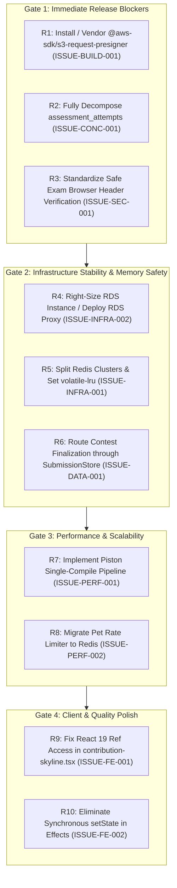

# Remediation Roadmap & Priority Engineering Plan (Commit `b846d107`)

**Audit Date:** October 18, 2026  
**Audited Target:** CodeSkill Platform  
**Commit Inspected:** `b846d107`  
**Auditor:** Principal Software Architect & Engineering Director  
**Output Location:** `engineering-audit/`  

---

## 1. Remediation Phase Hierarchy & Dependency Sequence

Remediation must proceed across four prioritized phases. No code should be deployed to production until Phase 1 and Phase 2 are fully completed and verified.



---

## 2. Gate 1: Immediate Release Blockers (Mandatory Hotfixes)

### Task 1.1: Resolve Missing S3 Presigner Dependency (ISSUE-BUILD-001)
- **Target Files:** `backend-nestjs/src/s3/s3.service.ts` & `node_modules/`
- **Severity:** CRITICAL
- **Complexity:** Low (0.5 engineering days).
- **Dependencies:** None.
- **Implementation Steps:**
  1. Populate `@aws-sdk/s3-request-presigner` and its dependency tree into `node_modules` (or vendor the bundle locally under `src/s3/vendor/`).
  2. Run `(cd backend-nestjs && npx --no-install tsc -p tsconfig.build.json --noEmit --incremental false)` and verify 0 errors.
  3. Run `npm test --prefix backend-nestjs -- --runInBand` and assert all 72 test suites pass.

### Task 1.2: Complete Concurrency Isolation for Assessments (ISSUE-CONC-001)
- **Target Files:** `backend-nestjs/src/assessments/assessments.service.ts` & database entities.
- **Severity:** CRITICAL
- **Complexity:** Medium (3 engineering days).
- **Dependencies:** None.
- **Implementation Steps:**
  1. Author a database migration creating `assessment_proctor_captures` (`id`, `attempt_id`, `url`, `type`, `captured_at`).
  2. Refactor `recordProctorCapture` to perform a pure SQL `INSERT INTO assessment_proctor_captures (...)` without modifying `assessment_attempts`.
  3. In `saveProgress`, replace `attemptRepo.save(attempt)` with an atomic parameterized query:
     ```sql
     UPDATE assessment_attempts
     SET responses = $1, time_spent_seconds = $2, updated_at = NOW()
     WHERE id = $3 AND status = 'in_progress';
     ```
- **Verification:** Run a Testcontainers-backed concurrency integration test dispatching 30 simultaneous saves and captures; assert 0 responses or captures are dropped.

### Task 1.3: Standardize Safe Exam Browser Cryptographic Verification (ISSUE-SEC-001)
- **Target Files:** `backend-nestjs/src/exam-security/exam-security.service.ts`
- **Severity:** HIGH
- **Complexity:** Low-Medium (1.5 engineering days).
- **Dependencies:** None.
- **Implementation Steps:**
  1. Remove `hasMatchingKey = clientSentKey === expectedConfigKey` from `initSecureSession`.
  2. Disallow setting `clientType = 'SEB'` based purely on `clientBody.isSEB` or User-Agent.
  3. Compute the expected RequestHash using the full request URL:
     ```typescript
     const fullUrl = `${req.protocol}://${req.get('host')}${req.originalUrl}`;
     const expectedHash = crypto.createHash('sha256').update(fullUrl + expectedConfigKey).digest('hex');
     ```
  4. Compare with `headers['x-safeexambrowser-requesthash']` using `crypto.timingSafeEqual`.
- **Verification:** Automated tests confirming that requests without genuine SEB header hashes are rejected with HTTP 403.

---

## 3. Gate 2: Infrastructure Stability & Memory Safety

### Task 2.1: Right-Size RDS Instance & Deploy RDS Proxy (ISSUE-INFRA-002)
- **Target Files:** `terraform/modules/rds/main.tf` & `terraform/environments/production/main.tf`
- **Severity:** HIGH
- **Complexity:** Medium (2 engineering days).
- **Implementation Steps:**
  1. Upgrade RDS instance class to `db.t4g.small` (2 GiB RAM) to safely support `max_connections = 200`.
  2. Provision AWS RDS Proxy between API and PostgreSQL, setting target connection pool max to 30.
  3. Lower backend `DB_POOL_MAX` to `10` per API instance.

### Task 2.2: Decouple BullMQ Redis from Cache / Throttler (ISSUE-INFRA-001)
- **Target Files:** `terraform/modules/redis/main.tf` & `backend-nestjs/src/app.module.ts`
- **Severity:** HIGH
- **Complexity:** Medium (2 engineering days).
- **Implementation Steps:**
  1. Deploy a dedicated Redis instance for BullMQ persistent queues (`noeviction`).
  2. Configure the caching and rate-limiting Redis cluster with `maxmemory-policy: volatile-lru`.

### Task 2.3: Route Contest Finalization through `SubmissionStore` (ISSUE-DATA-001)
- **Target Files:** `backend-nestjs/src/contests/contests.service.ts`
- **Severity:** MEDIUM
- **Complexity:** Low (1 engineering day).
- **Implementation Steps:** Replace `this.submissionRepo.find({ where: { contestId } })` with a query through `SubmissionStore` that aggregates submissions across all active shard instances.

---

## 4. Gate 3: Performance & Scalability

### Task 3.1: Piston Batch Compilation Pipeline (ISSUE-PERF-001)
- **Target Files:** `backend-nestjs/src/execution/execution.service.ts`
- **Severity:** HIGH
- **Complexity:** High (3–4 engineering days).
- **Implementation Steps:** For compiled languages (C, C++, Java, Rust), invoke Piston to compile source code into an executable binary once, cache the binary artifact in worker memory or shared volume, and execute test cases sequentially against the binary.

### Task 3.2: Distributed Redis Rate Limiter for AI Pet (ISSUE-PERF-002)
- **Target Files:** `backend-nestjs/src/pet/pet.service.ts`
- **Severity:** MEDIUM
- **Complexity:** Low (1 engineering day).
- **Implementation Steps:** Replace in-process `Map` with Redis sliding window counter (`INCR` with 60s `EXPIRE`).

---

## 5. Gate 4: Client & Quality Polish

### Task 4.1: Fix React 19 Ref Access During Render (ISSUE-FE-001)
- **Target Files:** `frontend-v2/src/components/ui/contribution-skyline.tsx`
- **Severity:** LOW
- **Complexity:** Low (0.5 engineering days).
- **Implementation Steps:** Move `cfg.current = ...` into `React.useEffect` to eliminate React 19 concurrent render compiler warnings.

### Task 4.2: Eliminate Synchronous `setState` in Effects (ISSUE-FE-002)
- **Target Files:** `frontend-v2/src/components/ui/otp-input.tsx` & `modern-loader.tsx`
- **Severity:** LOW
- **Complexity:** Low (0.5 engineering days).
- **Implementation Steps:** Derive state values during render instead of scheduling synchronous state updates inside `useEffect`.
